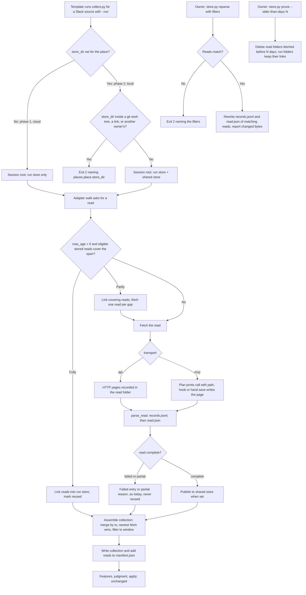
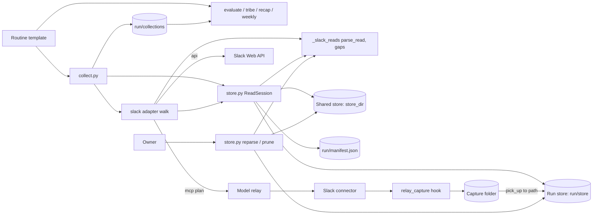
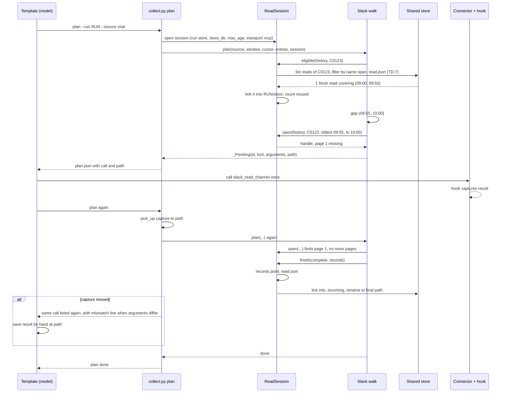
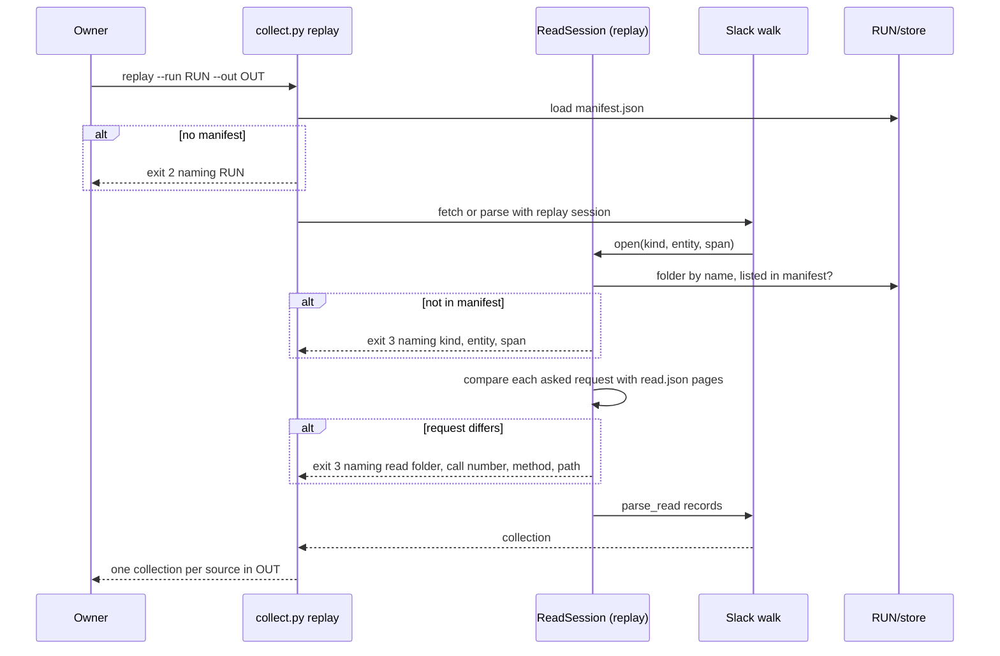

# Provider Store: Design

## Architecture Overview

A read session sits between the collector and the Slack adapter. The adapter's walk (which channels, threads, searches, reactions and users a source needs) stays as it is; every read it makes goes through the session, which files the read's pages, parses them into records and decides, in phase 2, whether a stored read can stand in for a fetch.

Components:
- `store.py` (new): the read session, the read folder format, the shared store (link in, publish out), reuse eligibility, span gaps, the run manifest, and the `reparse` and `prune` commands.
- `providers/_slack_reads.py` (new): the Slack read kinds, their entity paths and spans, record serialization, `parse_read`, and the gap-filled history and thread reads.
- `providers/slack.py`, `_slack_read.py`, `_slack_search.py` (modified): the walk asks the session for reads; page parsers depend on the read alone; window filters move to collection assembly.
- `collect.py` (modified): `--run <run>` replaces `--responses` and `--raw`, store-backed adapters get a session, the plan prints a save `path` per call, the capture pick-up writes there, and each collection adds its reads to `<run>/manifest.json`.
- Run store: `<run>/store/provider=<key>/...`, every read a run uses, written or linked.
- Shared store (phase 2): `<store_dir>/provider=<key>/...`, the reads of every run of the place.
- Both stores use hive-style `key=value` folders (TD-13), so DuckDB, Polars or pyarrow can query them without the runtime.
- Unchanged: `relay_capture.py`, `_http.py`, `_replay.py`, the features, judgment and state engines, and the raw layout of the other providers.

## Usage Flow



## Component Diagram



## Technical Decisions

### TD-1: The read folder is the unit of storage, reparse and replay

**Choice**: one folder per read: its pages in call order, `records.jsonl`, then `read.json` written last. Only `reparse` rewrites a folder, and only its `records.jsonl` and `read.json`, each by an atomic rename.
**Alternatives considered**:
- Merged per-day and per-thread files: rejected, two runs rebuilding the same file in a shared store can drop each other's reads, and coverage would live in two places.
- One file per page: rejected, a page parse depends on earlier pages of the read (seen ts, forged-header guards, newest-first thread pages).

**Rationale**: a folder written once needs no lock, `read.json` marks completeness (BR-3), and reparse rewrites two files per read (BR-2). A reader that meets a reparse halfway sees a `parsed_by` that does not match its records and reparses the read itself (AC-7.9).

### TD-2: Read identity and folder name

**Choice**: `<entity path>/read=<from>_<to>-<run id>.<source>` for reads with a span, `<entity path>/read=<run id>.<source>` otherwise, the entity path following BR-1. `<from>` is the read's `oldest` argument (the root ts for a whole-thread read). `<to>` is its `latest` argument, or the window end of the run that made it when the tool takes no `latest` (connector thread reads). `<run id>` is the run folder's name.
**Alternatives considered**:
- A content hash: rejected, the plan must print the save path before the call returns.
- The fetch time: rejected, every plan step of one run recomputes the walk and must find the same folder.
- `<run id>` without the source: rejected, two sources of one run asking the same read would share it, which phase 1 forbids (BR-4).

**Rationale**: the name is known before the call, stable across plan steps, unique across runs and sources, and carries the span, so selection filters on names before opening any `read.json` (AC-3.1).

### TD-3: Page parsers depend on the read alone

**Choice**: page parsers take the read's arguments and its `<to>`; the window filters (`_in_window`, the hit `_within` check) move to collection assembly. A connector thread read still drops replies after `<to>`, which equals today's window end.
**Alternatives considered**:
- Store window-filtered records: rejected, another routine with another window could not reuse them.
- Drop the `<to>` bound from connector thread reads: rejected, it changes the guard order on replies after the window end, which BR-4 forbids.

**Rationale**: records then mean the same thing to every reader, and the same pages give the same records today and after the change.

### TD-4: A read session replaces `responses` and `http` for store-backed adapters

**Choice**: an adapter with `STORE = True` receives a `ReadSession` where it received `responses` (plan, parse) or `http` (fetch). The walk calls `session.open(kind, entity, span)`, with the entity keys and span `_slack_reads` derives from the read's arguments and `to`, and gets a handle with `page(request)` and `finish(outcome, records)`; reuse goes through `session.eligible(kind, entity, span, minutes, window_end)`. `parse_read(kind, read, pages)` becomes an adapter entry point.
**Alternatives considered**:
- Keep `<source>-<n>` relay ids and file responses into the store after parsing: rejected, two copies of every page, and the ids depend on walk order, which phase 2 reuse changes.
- Let the adapter write files: rejected, file IO inside adapters, and their tests would need a file system.

**Rationale**: the adapter stays pure and testable with an in-memory session; the session owns every path, permission and atomic write.

### TD-5: `--run <run>` replaces `--responses` and `--raw`

**Choice**: `fetch`, `plan`, `parse` and `replay` take `--run <run>` for every provider. A store-backed adapter works under `<run>/store` and keeps its relay files in `<run>/relay/<source>/`; the other adapters keep `<run>/raw/<role>/<source>/`. Each planned call carries an absolute `path`, and the templates save a missed capture there.
**Alternatives considered**:
- Keep `--responses` and add `--store`: rejected, the templates would compose two layouts and branch per role.

**Rationale**: one flag, the adapter's layout stays out of the templates, and the hand-save fallback stops depending on how ids map to files (AC-1.7).

### TD-6: The run store is the working area; the shared store is linked in and out

**Choice**: a reused read is hard-linked from the shared store into the run store at first use; a new read is written in the run store and published by linking its files into `<store_dir>/provider=<key>/.incoming/<random>/`, then renaming that folder to its final path. Linking falls back to copying across file systems.
**Alternatives considered**:
- Read from the shared store in place: rejected, a prune or a publish during the run would change what later plan steps see, and replay would depend on the shared store.
- Always copy: rejected, doubles the disk use of every reused read.

**Rationale**: plan steps and replay see one stable set of reads (`<run>/store`), a prune never breaks a kept run (AC-8.6), and the rename publishes a whole read at once (BR-3).

### TD-7: Reuse eligibility

**Choice**: a stored read is eligible when all hold:
- `max_age` for its kind is above 0 (AC-7.5)
- same provider key (BR-12)
- outcome `complete` (BR-8)
- kind is not `search` (BR-9)
- transport allowed by the trust rule (BR-7)
- window end minus fetch time is at most `max_age` minutes (BR-11)
- fetched before the window end, or by another source of the same run

**Alternatives considered**:
- Lock the store during a run: rejected, it serializes routines that only read.
- Let a source reuse its own reads: rejected, a replay would then count as reused what the run fetched.

**Rationale**: excluding reads that other runs publish after the window end keeps every plan step of a run, and its replay, on the same eligible set.

### TD-8: Gap fill on Slack ts intervals

**Choice**: coverage is the union of the eligible reads' `(from, to]` intervals, compared as decimals. Each gap of the needed span becomes one read, in ascending order; a thread is read from the end of its covered part. Records merge by ts, the newest fetch winning (BR-5), then filter to the needed span.
**Alternatives considered**:
- Refetch the whole span when it is only partly covered: rejected, overlapping windows of two routines are the common case and would save nothing.

**Rationale**: a routine running minutes after another fetches about one page per channel.

### TD-9: `max_age` shape

**Choice**: a chat source option, an integer of minutes for every kind, or an object with `default`, `history`, `thread`, `reactions` and `people`, each a non-negative integer; a missing kind takes `default`, and a missing `default` is 0.
**Alternatives considered**:
- Top-level keys per kind (`max_age_history`, ...): rejected, five more source options for one setting.

**Rationale**: one key, with the common case a single number.

### TD-10: Reuse counts travel in the collection only when reuse is on

**Choice**: `collect.py` adds `reads: {"fetched": N, "reused": M}` from the session's counts to a collection only when its source's `max_age` is above 0 for some kind; `evaluate.run_context` and the weekly source rows copy it into the run record.
**Alternatives considered**:
- Always add `reads`: rejected, it changes phase 1 collections (BR-4, AC-7.5).
- Counts in the manifest only: rejected, the run records come from collections, and 4 engines would need a new input.

**Rationale**: AC-7.11 holds for every source that reuses, and a source without reuse writes the same bytes as phase 1.

### TD-11: `store.py` holds the store library and its commands

**Choice**: a new `store.py`, library and CLI like `state.py`, with `reparse` and `prune`. `read.json` names the adapter module, so `reparse` needs no config.
**Alternatives considered**:
- Subcommands of `collect.py`: rejected, 815 lines already, and store maintenance is not collection.

**Rationale**: one module owns the read folder format; `collect.py` only wires sessions.

### TD-12: Replay runs the walk on the run's own reads

**Choice**: `replay` builds a session in replay mode: root `<run>/store`, no shared store, no network, eligible reads limited to the manifest. A read the walk asks for resolves by its folder name; for both transports, each asked request is compared with the one `read.json` recorded for that page, and the saved page is served. The manifest is required only when the routine has a store-backed source.
**Alternatives considered**:
- Replay as reparse only: rejected, a walk change (which reads, which arguments) would go unchecked (AC-5.2, AC-5.3).

**Rationale**: replay checks both the walk and the parsers, read by read.

### TD-13: Hive-style folders, kind first, records as JSON lines

**Choice**: every folder level is `key=value` (`provider=`, `kind=`, then the entity keys, then `read=`); `kind=` comes right after `provider=`; records are JSON lines (`records.jsonl`), and a record holds no value its path holds.
**Alternatives considered**:
- Plain names (`channels/<channel>/history/...`): rejected, path parts carry no key, and query tools cannot turn them into columns.
- Entity first (`channel=/kind=`): rejected, one subtree would mix the record shapes of 5 kinds, so a glob could not read it as one table.
- A `day=` partition: rejected, a read spans days and is the parse unit (BR-2); splitting records by message day inside a read stays possible later.
- One JSON document per read (`records.json`): rejected, query tools would read one row holding a list, not one row per record.

**Rationale**: a path names its own keys, a tool reads one kind as one table with the path values as columns, and leaving those values out of the rows follows the hive convention and avoids a column clash.

## Implementation Considerations

### Data Model

Slack store layout, under a store root (`<run>/store` or `<store_dir>`):

```text
provider=<key>/
  kind=history/channel=<channel>/read=<from>_<to>-<run id>.<source>/
  kind=thread/channel=<channel>/root=<root ts>/read=<from>_<to>-<run id>.<source>/
  kind=reactions/channel=<channel>/message=<message ts>/read=<run id>.<source>/
  kind=members/channel=<channel>/read=<run id>.<source>/
  kind=users/user=<user id>/read=<run id>.<source>/
  kind=search/search=<search name>/read=<from>_<to>-<run id>.<source>/
  .incoming/                     shared store only, publishes in progress
```

Each read folder:

```text
page-001.json | page-001.txt     api HTTP record (providers README format) | connector text, byte-exact
records.jsonl                    one record per line, written after the last page
read.json                        written last
```

`read.json`:

```json
{
  "schema": 1,
  "adapter": "slack",
  "provider": "chat",
  "kind": "history",
  "entity": {"channel": "C0123"},
  "span": {"from": "1729400000.000000", "to": "1729407600"},
  "transport": "mcp",
  "run": "20261020T090000Z-k3x9q2",
  "source": "chat",
  "fetched_at": "2026-10-20T09:00:41Z",
  "pages": [{"file": "page-001.txt", "request": {"tool": "slack_read_channel", "arguments": {"channel_id": "C0123", "oldest": "1729400000.000000", "latest": "1729407600", "limit": 30, "response_format": "detailed"}}}],
  "outcome": {"status": "complete", "reason": null},
  "parsed_by": "<runtime commit or null>"
}
```

- `request` is `{tool, arguments}` for a connector page and `{method, path, query, body}` for an api page; neither holds a header.
- `outcome.status` is `complete`, `failed` or `partial`; `reason` is today's failed-entry code or `partial:` reason.
- `parsed_by` is `git rev-parse HEAD` of the runtime checkout that wrote `records.jsonl`, null when unknown; a null or different commit makes a reused read reparse before use (AC-7.9).

`records.jsonl` of a history read, one canonical compact JSON object per line:

```text
{"author":"U01","bot":false,"name":"","text":"Release 4.2 is out","thread_ts":"1729400100.000200","ts":"1729400100.000200"}
{"author":"U02","bot":false,"name":"","text":"<@U03> can you check the rollback","thread_ts":null,"ts":"1729400410.000900"}
```

| Kind | One line per | Fields (the path adds the rest) |
|---|---|---|
| `history` | Message | `ts`, `thread_ts`, `author`, `text` (uncleaned, uncut), `name`, `bot`; path adds `channel` |
| `thread` | Root or reply, the root once per connector page | `ts`, `author`, `text`, `name`, `bot`; path adds `channel` and `root`, and `thread_ts` is `root` |
| `search` | Hit, before the channel type filter | The adapter's `Hit`: `channel`, `name` (the channel's), `kind`, `participants`, `root`, `kind_type`, and `item` (`ts`, `thread_ts`, `author`, `text`, `name`, `bot`) |
| `reactions` | Reacting user, sorted | `user`; path adds `channel` and `message` |
| `members` | Member, `api` only | `id`; path adds `channel`; names come from `users` reads |
| `users` | User (one line), `api` only | `name` (empty for an unknown user); path adds `user` |

`<run>/manifest.json`:

```json
{"schema": 1, "sources": {"chat": {"reads": ["provider=chat/kind=history/channel=C0123/read=1729400000.000000_1729407600-20261020T090000Z-k3x9q2.chat"], "fetched": 4, "reused": 0}}}
```

Config:
- `places.<place>.store_dir`: optional, the path rules of `runs_dir`.
- Chat source `max_age`: TD-9.
- Collection: optional `reads` (TD-10). Run record `run_context.collected.<source>.reads` and weekly `sources[].reads`: optional, same shape.

### API / Interface

```text
python3 runtime/collect.py fetch  --config C --routine R --source S --place P --window W --state ST --run RUN [--sources F] --out COLLECTION
python3 runtime/collect.py plan   --config C --routine R --source S --place P --window W --state ST --run RUN [--sources F] --out PLAN
python3 runtime/collect.py parse  --config C --routine R --source S --place P --window W --state ST --run RUN [--sources F] --out COLLECTION
python3 runtime/collect.py replay --config C --routine R --place P --window W --state ST --run RUN [--sources F] --out DIR
python3 runtime/store.py reparse  --root ROOT [--provider P] [--channel C ...] [--thread C:TS ...] [--kind K ...] [--from T] [--to T]
python3 runtime/store.py prune    --root STORE_DIR --older-than-days N [--dry-run]
```

- A planned call: `{"id", "connector", "tool", "arguments", "path"}`. A store-backed id is the read folder's path under the provider, plus `/page-<NNN>`; the other adapters keep `<source>-<n>`.
- `reparse` prints one line per read, `changed` or `same`, then the counts; `--from` and `--to` are UTC times and select reads whose span overlaps.
- `prune` prints `<provider> deleted <N> kept <M>` per provider.
- Exit codes follow the plugin README: 2 for usage and input, 3 for a rejected read, record or replay request.

Querying the store with an outside tool needs no runtime code. DuckDB example:

```sql
SELECT channel, root, ts, author, text
FROM read_json('/srv/claudio-store/provider=chat/kind=thread/*/*/*/records.jsonl',
               format = 'newline_delimited',
               hive_partitioning = true,
               hive_types_autocast = false)
WHERE channel = 'C0TRIBE1' AND root = '1792394100.000200';
```

`hive_types_autocast = false` keeps the ts values as text, so no microsecond is lost to a numeric cast.

Adapter entry points of a store-backed adapter:

```python
STORE = True
def fetch(source, window, cursor, entries, session): ...
def plan(source, window, cursor, entries, session, connector): ...
def parse(source, window, cursor, entries, session, digests): ...
def parse_read(kind, read, pages): ...  # read: the read.json document; pages: list of page bytes, in order
```

`ReadSession` (store.py):

```python
session.open(kind, entity, span) -> ReadHandle            # entity: ordered (key, value) pairs; span: (from, to) or None
handle.page(request, fetch=None) -> bytes                  # saved page, else fetch() saved, else PagePending for the relay
handle.records() -> [dict]                                 # rows of a complete read, without the path values
handle.finish(outcome, records)                            # records.jsonl then read.json, then publish
session.eligible(kind, entity, span, minutes, window_end) -> [Reuse(read, rows)]  # TD-7, oldest fetch first, linked into the run store on use
session.link_in(read) -> StoredRead                        # shared read linked into the run store, read.json last
session.shared_reads(kind, entity, span) -> [StoredRead]   # reads under <store_dir>/provider=<key>
session.counts() -> {"fetched": N, "reused": M}
store.gaps(needed, spans) -> [(from, to)]                  # TD-8, ascending
store.merge_newest(groups, key) -> [record]                # BR-5, groups ordered oldest fetch first
```

### Performance

- Selection lists only the folders of the entities a source names, and filters reads by the span in their names before opening a `read.json`.
- Reading a stored read costs one `read.json` and one `records.jsonl`; a reparse is local and runs per read.
- Folder count grows by at least one history read per channel per run, plus one per gap, and only `prune` bounds it (BR-10).
- A reused read is linked, not copied, when the run folder and `store_dir` share a file system.

### Security

- `store_dir`: created 0700, files 0600, refused when it is a link, belongs to another user, or lies inside a git working tree that does not ignore it (BR-6, AC-6.3, AC-6.4).
- Path parts come from tool output (channel ids from search hits, user ids, ts): each must match a strict pattern (ids `[A-Z0-9]{1,32}`, ts `[0-9]{1,16}\.[0-9]{1,9}`) before it reaches a path, else the read fails with `invalid entity id`. No `/`, `.` or `..` part is ever built from tool text.
- A search name is config text (any label): its folder is the name percent-encoded with no safe character, and a name `.` or `..` fails the config load.
- Trust: an `api` source never reads records parsed from connector text (BR-7), so a forged connector message cannot reach it through the store.
- Provider isolation: one folder per provider key, so a source never sees reads made with another credential (BR-12).
- No credential in any store file: api page records keep today's no-header rule (routines-as-code BR-71).

## Sequence Diagrams

Connector read with reuse and publish, phase 2:



Replay of a run:



## File Inventory

All paths under `plugins/claudio-routines/` unless they start with `docs/`.

| File | Action | Purpose |
|---|---|---|
| `runtime/store.py` | new | ReadSession, read folder format, eligibility, gaps, link and publish, manifest, `reparse` and `prune` CLI |
| `runtime/test_store.py` | new | Session, eligibility, gaps, atomic publish, permissions, manifest, reparse and prune commands |
| `runtime/providers/_slack_reads.py` | new | Slack read kinds, hive entity paths and id patterns, spans, JSON lines records, `parse_read`, gap-filled history and thread reads |
| `runtime/providers/test_slack_reads.py` | new | `parse_read` per kind, entity validation, gap-filled reads |
| `runtime/providers/_slack_read.py` | modify | Channel and thread reads through session handles; page parsers bound by the read's `to`, not the window |
| `runtime/providers/_slack_search.py` | modify | Search, conversation, thread, members, users and reactions reads through session handles |
| `runtime/providers/slack.py` | modify | `STORE`, `parse_read`, entry points taking a session, window filters at assembly |
| `runtime/providers/slack_support.py` | modify | Test harness: in-memory session holding fixture pages by read |
| `runtime/providers/test_slack.py` | modify | Same fixtures through the session; byte-identical collections |
| `runtime/providers/test_slack_search.py` | modify | Same fixtures through the session; byte-identical units |
| `runtime/providers/test_conformance.py` | modify | A store-backed adapter exposes `parse_read` |
| `runtime/collect.py` | modify | `--run`, sessions for store-backed adapters, `path` per call, pick-up to path, manifest, replay session, `store_dir` checks in `sources`, optional `reads` counts in the collection |
| `runtime/test_collect.py` | modify | `--run` flags, relay paths, manifest, replay per read, mismatch line kept, `store_dir` refusals |
| `runtime/roles.py` | modify | `store_dir` place key, chat `max_age`, search names `.` and `..` refused, optional collection `reads` |
| `runtime/test_roles.py` | modify | `store_dir`, `max_age` and search name validation |
| `runtime/evaluate.py` | modify | `run_context` copies `reads` |
| `runtime/state.py` | modify | Run context `collected.<source>.reads` optional |
| `runtime/test_evaluate.py` | modify | `reads` copied into the run context |
| `runtime/test_state.py` | modify | Run record keeps `reads` |
| `runtime/weekly_features.py` | modify | Source rows carry `reads` |
| `runtime/weekly.py` | modify | Weekly record sources keep `reads` |
| `runtime/test_weekly.py` | modify | Weekly record `reads` |
| `skills/routines/scripts/routines.py` | modify | `store_dir` path check in the config check and `lint --private` |
| `skills/routines/scripts/test_routines.py` | modify | `store_dir` path rules |
| `skills/routines/templates/prod-watch.md` | modify | `--run <run>`, hand save at the call's `path` |
| `skills/routines/templates/tribe-digest.md` | modify | `--run <run>`, hand save at the call's `path` |
| `skills/routines/templates/chat-recap.md` | modify | `--run <run>`, hand save at the call's `path` |
| `skills/routines/templates/weekly-status.md` | modify | `--run <run>`, hand save at the call's `path` |
| `example/config.json` | modify | `store_dir` on the local place |
| `example/config/routines/chat-recap.json` | modify | Example `max_age` object |
| `README.md` | modify | Store section, Collectors, Relay capture save path, Offline replay, Local runs, config keys, Troubleshooting |
| `runtime/providers/README.md` | modify | Saved responses, recorded and replayed calls per read, Slack read layout |
| `docs/features/routines-as-code/requirements.md` | modify | AC-51.1 and AC-51.4 point to provider-store for chat sources |

## Non-Functional Requirements

- **NFR-1** (Compatibility): with the same raw responses, phase 1 leaves every existing fixture, golden and pipeline test expectation unchanged; the other providers keep their raw layout and relay ids.
- **NFR-2** (Determinism): every plan step of one run, its final parse and its replay see the same reads and write the same bytes; every JSON file is canonical (sorted keys, 2-space indent), and every JSON lines file holds one canonical compact object per line.
- **NFR-3** (Concurrency): two runs of one place collecting at once never read a partial read and never overwrite each other's files; publishing is a single rename.
- **NFR-4** (Security): store folders 0700 and files 0600; no path part built from tool text outside its pattern; no credential in any store file.
- **NFR-5** (Portability): standard library only, Python 3.10.12 or later; hard links with a copy fallback on `EXDEV` and `EPERM`.
- **NFR-6** (Performance): collecting a source opens no `read.json` outside its entities' folders, and no read whose span name lies outside the needed span.
