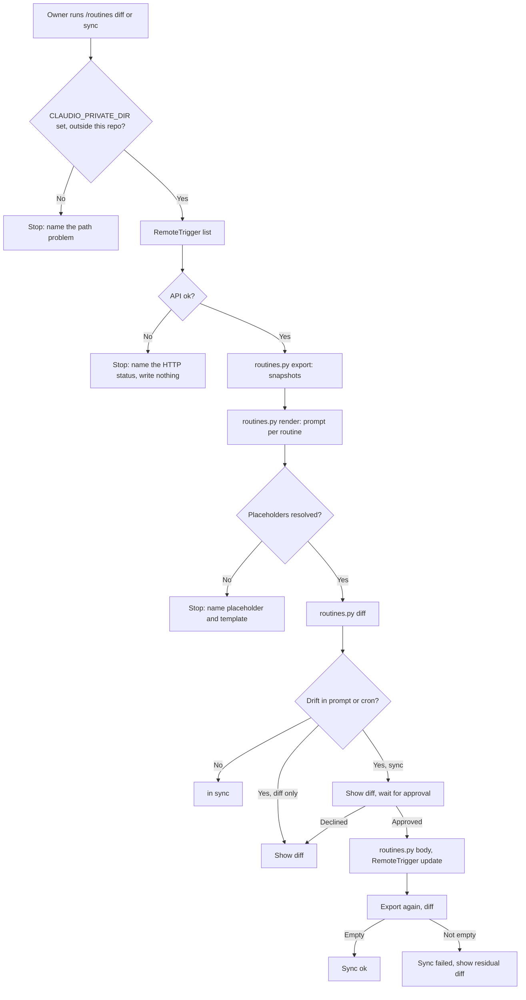
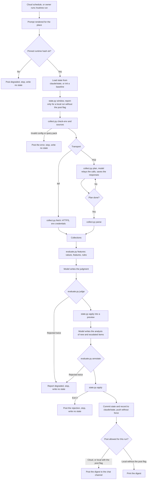
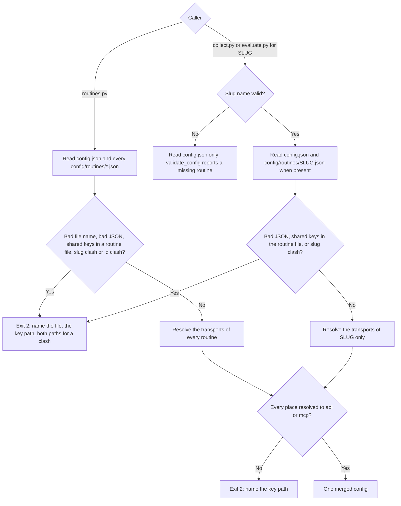
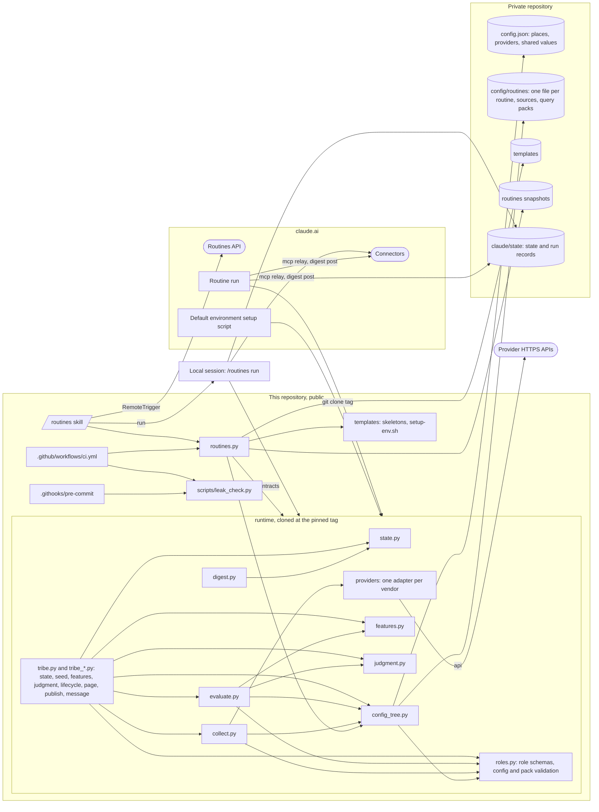
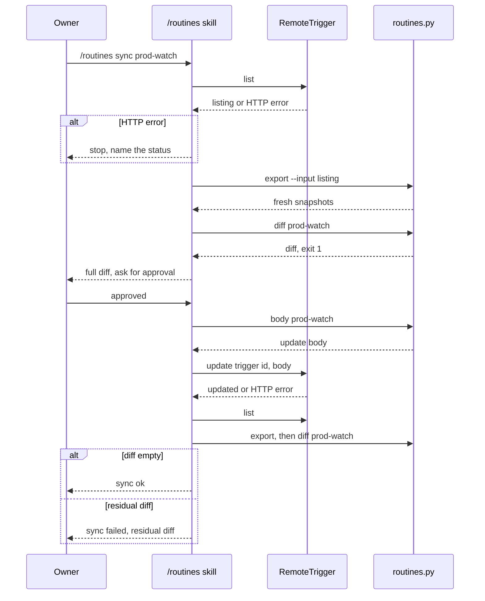
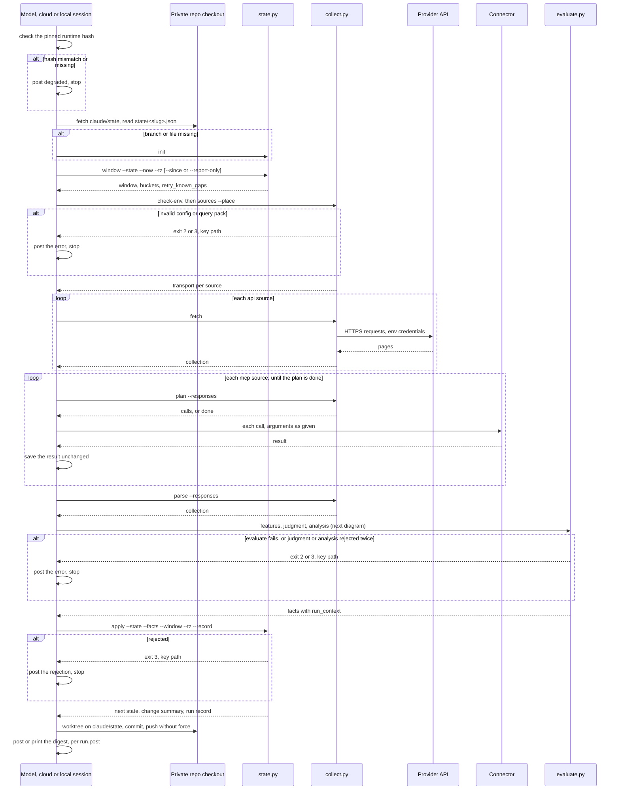
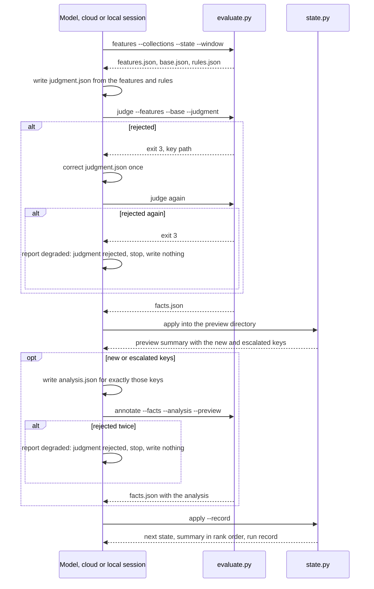
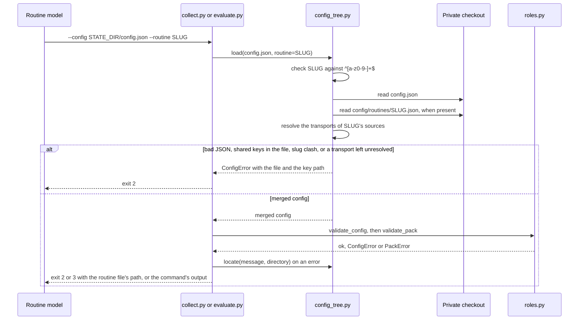
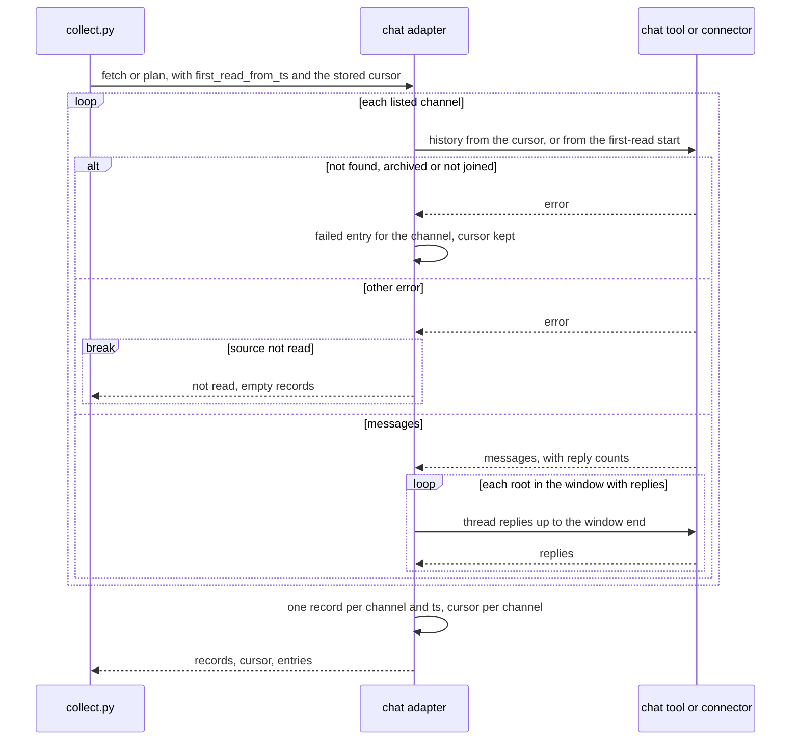
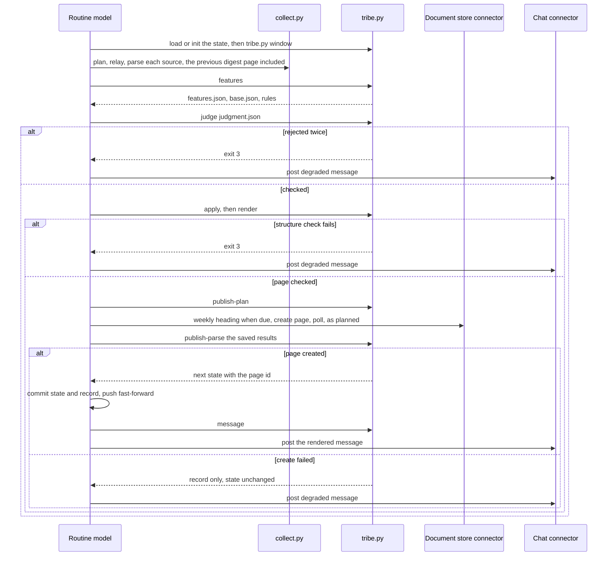

# Routines as Code: Design

## Architecture Overview

Five parts, one new plugin, one private repository.

- **Leak guard**, at the repository root:
  - `scripts/leak_check.py` scans staged changes, the tree, or the history, and prints `path:line:rule`.
  - The pre-commit hook runs it on staged changes; CI runs it on the tree.
  - CI also runs the unit tests and the template lint.
- **Routine tooling**, in the new plugin `plugins/claudio-routines`:
  - The `/routines` skill drives the routines API through Claude's `RemoteTrigger` tool, the only client that holds the OAuth token.
  - `routines.py` does every file operation: normalize an API listing into snapshots, render templates, diff, lint, and build the update body.
  - Public skeletons sit in the plugin; real templates and render-time values sit in the private repository.
  - `runtime/config_tree.py` loads the private config for the skill and the runtime: the shared `config.json` plus one file per routine (TD-34).
- **State engine**, in `plugins/claudio-routines/runtime/state.py`:
  - Computes the run window and the item lifecycle from the previous state and the facts the evaluator writes.
  - Cloud runs get it from a setup script on the default environment, which clones this repository at a pinned tag.
  - Each run reads and writes its state as a JSON file on the `claude/state` branch of the private repository, with one run record per run for stats.
  - `runtime/digest.py` renders Prod watch's posted message from the change summary, the next state, the run record and the base file (TD-33).
- **Collectors**, in `plugins/claudio-routines/runtime/`:
  - `collect.py` reads one source of a routine for a window and writes a collection file in the schema of the source's role.
  - The `api` transport calls the provider's HTTPS API with credentials from environment variables.
  - The `mcp` transport writes a plan that the model relays through a claude.ai connector, then parses the saved responses.
  - The private config picks the transport per source and per place (`cloud`, `local`).
  - `providers/` holds one adapter module per vendor.
  - `evaluate.py` computes Prod watch's features from the collections, the query pack and the state, checks the model's judgment and analysis against them, and writes the facts `state.py` takes.
  - The routine's model judges the features against the routine's prose rules: it writes the verdicts (`open`, `severity`, `urgency`, `rank`, `cites`) and the analysis of new and escalated items, and sets no fact value.
  - A routine runs in the cloud on its schedule, or locally through `/routines run`, from the same template and the same pinned runtime.
- **Tribe engine**, in `plugins/claudio-routines/runtime/tribe.py` and its `tribe_*.py` modules (TD-45):
  - Runs a routine whose `engine` is `tribe`, from the same collectors: window, seed, features, judgment check, lifecycle, page render with its structure check, connector write plans and chat message.
  - Keeps its state as `tribe-1` JSON on the `claude/state` branch, with the cursors of every source (TD-46).
  - Reuses the window, blind spot and text rules of `state.py` and the cite helpers of `judgment.py`.
  - The routine's model writes only `judgment.json`; the page and the message are the scripts' output.

The private repository (`$CLAUDIO_PRIVATE_DIR`) holds `config.json`, `config/routines/`, `templates/` and `routines/` snapshots on its main branch, and the run state on `claude/state`. CI never reads it, and no script writes it into this repository.

The routines name roles, not providers: an observability tool (monitors, metrics, alert events), a chat channel (the digest, and messages to read), a document store (the sources page with the mutes), a code host (pull requests and issues) and an issue tracker (the tribe digests' filters). Which product fills each role is a private configuration choice: a source's `provider` in `config.json` picks the adapter.

## Usage Flow



A routine run, in the cloud on its schedule or locally through `/routines run`:



Loading the private config, for a skill command or a runtime command:



## Component Diagram



## Technical Decisions

### TD-1: One stdlib scanner for hook, CI and history

**Choice**: `scripts/leak_check.py` with five modes:
- `--staged`: the lines added in the staged diff, and the staged paths.
- `--tree`: every line and every path of the text files that git tracks or would track (`git ls-files --cached --others --exclude-standard`).
- `--history`: the lines added by every commit reachable from all branches, the paths each commit adds or renames (both sides of a rename), and every commit message.
- `--range A..B`: the same as `--history`, for the commits of one range; CI scans the pushed or pull request commits with it.
- `--message FILE`: one commit message, for the commit-msg hook.

Files holding a NUL byte are scanned too, decoded as UTF-16 when they start with a BOM and as latin-1 otherwise; git diffs run with `--text`.

Removed lines are never scanned, so the commit that deletes a leak passes.

**Alternatives considered**:
- gitleaks: rejected, an external binary on every machine, and its reports print the match unless redaction is set everywhere.
- detect-secrets: rejected, a pip dependency, and it targets secrets, not deny-words or ids.

**Rationale**: zero dependencies, one rule set for all three modes, and full control of the output (BR-2).

### TD-2: Rules and output

**Choice**: named rules and three output shapes, exit 0 clean, 1 findings, 2 cannot run:
- `path:line:rule` for a line, `path:0:rule` for a path finding.
- `commit:path:line:rule` in history mode, and `commit:<message>:line:rule` for a commit message.
- Any part of a printed path that matches a rule is replaced by `<redacted>`.

| Rule | Pattern |
|---|---|
| `slack-id` | `(?<![A-Za-z0-9])[A-Z][A-Z0-9]{8,11}(?![A-Za-z0-9])` with at least 2 digits after the first character |
| `notion-id` | 32 hex characters of either case bounded by `(?<![0-9A-Za-z])` and `(?![0-9A-Za-z])`, or a case-insensitive UUID bounded by `(?<![0-9a-f-])` and `(?![0-9a-f-])` |
| `aws-account` | `(?<![0-9A-Za-z])(?<![0-9a-f]{4}-)[0-9]{12}(?![0-9A-Za-z])`, or the dashed form `dddd-dddd-dddd` with the same anchoring |
| `atlassian-account` | `[0-9]{6}:[0-9a-f-]{36}`, or 24 lowercase hex characters bounded like `notion-id` |
| `token` | `gh[pousr]_[A-Za-z0-9]{36}`, `github_pat_[A-Za-z0-9_]{22,}`, `xox[abprs]-[A-Za-z0-9-]{10,}`, `AKIA[0-9A-Z]{16}`, `sk-ant-[A-Za-z0-9_-]{20,}`, `-----BEGIN [A-Z ]*PRIVATE KEY-----` |
| `home-path` | `(?<![\w.])/(Users\|home)/[A-Za-z0-9._-]+`, `Users` matched case-insensitively |
| `deny-word` | each entry `re.escape`d, matched case-insensitively as a substring; an entry starting with `=` matches only between non-alphanumeric characters (AC-1.9) |

Bounded hex rules skip 40-character commit hashes, since a 32-hex match inside them has hex neighbours.

**Alternatives considered**:
- Printing a masked match: rejected, a masked company name still leaks its length and first letters.
- Exit 1 for "cannot run": rejected, CI could not tell a leak from a broken job.

**Rationale**: exit code 2 lets the hook and CI fail closed (BR-17) with a distinct message.

### TD-3: Deny-words sources

**Choice**:
- Local: the file named by `CLAUDIO_DENY_WORDS_FILE`, default `~/.config/claudio/deny-words.txt`, one entry per line, `#` comments.
- CI: the `LEAK_DENY_WORDS` environment variable, one entry per line, set from a repository secret in the leak-check step's `env` only.
- With `--require-deny-words`, the scanner exits 2 when the source is unset, empty, or has no entry once blank and `#` lines are dropped. CI passes the flag; the hook does not (AC-1.5).
- A fork guard step runs first when `github.event.pull_request.head.repo.full_name != github.repository`: it prints that the secret is not available to forks and exits 1 (AC-2.6).
- The workflow never uses `pull_request_target`.
- On a push, CI scans `before..after`; when `before` is not in the fetched history (a force push) or is all zeros (a new branch), it scans the full history instead.

**Alternatives considered**:
- A deny-words file committed encrypted: rejected, the key would still need a secret, for no gain.

**Rationale**: the words never touch the repository, and CI fails closed when the secret is absent.

### TD-4: Allowlist

**Choice**: `scripts/leak-allow.txt`, one entry per line: `path:<glob> <rule>` or `commit:<short-hash> <rule>`.
Initial entries:
- `path:plugins/claudio-rust/skills/rust-hexagonal/references/openapi-utoipa.md notion-id` (an RFC example UUID).
- `commit:174491e deny-word`, the onboarding commit whose examples were made generic later.

Commit entries need at least 7 hex characters and apply only in history mode; path entries never apply to commit messages.

**Alternatives considered**:
- Inline `leak-allow` comments: rejected, they need editing the flagged file and do not cover commits.

**Rationale**: covers examples and acknowledged commits (AC-3.4) without ever storing the match (BR-3).

### TD-5: Hook installation and branch protection

**Choice**:
- `scripts/install-hooks.sh` sets `core.hooksPath` to `.githooks`; running it twice is a no-op (AC-1.7).
- `commit-msg` scans only the message git keeps: it cuts the file at the scissors line and strips comment lines (`core.commentChar` aware) before `--message`.
- `scripts/check_protection.py` reads the protection of main through `gh api`. It exits 0 only when main requires a pull request, the `leak-check` status and enforcement for admins; 1 otherwise; 2 when `gh` fails (AC-2.5).
- The README documents the one-time `gh api` call that sets that protection.

**Alternatives considered**:
- Setting protection from CI: rejected, it needs an admin token in Actions.

**Rationale**: protection is a one-time owner action, and the check script makes its state verifiable.

### TD-6: A new plugin

**Choice**: `plugins/claudio-routines`, version 0.1.0, listed in the marketplace.
**Alternatives considered**:
- A skill inside `claudio-tools`: rejected, it ships runtime scripts that cloud runs pin by tag, which would couple their release to unrelated skills.

**Rationale**: an independent plugin and version, and a stable path for the runtime.

### TD-7: Template syntax

**Choice**: `{{dotted.key}}` placeholders, `\{{` for a literal marker, rendered by a stdlib regex.
**Alternatives considered**:
- `string.Template` (`$key`): rejected, prompts contain shell commands with `$`.
- Jinja2: rejected, a dependency, and loops or conditionals would move logic into templates.

**Rationale**: no logic in templates, unambiguous next to shell and JSON text.

### TD-8: Private repository location

**Choice**: the `CLAUDIO_PRIVATE_DIR` environment variable; `--private` overrides it. The script refuses a private path that lies inside another git working tree: the private directory must be the root of its own repository, or outside git, and its parent directory must not be inside a working tree (AC-4.7). It also refuses a claudio checkout given as the private directory.
**Alternatives considered**:
- A default path under the home directory: rejected, it would put a personal path into public code.

`routines.py check-private` runs the same checks alone, so the skill calls it before any API call (AC-4.4, AC-4.7).

**Rationale**: no personal path in this repository, and no way for an export to land in a tree that another repository could commit, whether the script runs from a checkout or from the plugin cache.

### TD-9: Snapshots as two files per routine

**Choice**:
- `routines/<slug>.json` holds id, name, cron, enabled flag, environment id, model, tools, the full `session_context` and the connector names, with sorted keys.
- `routines/<slug>.prompt.md` holds the prompt text.
- The slug comes from the routine name; two routines with the same slug stop the export.
- Every file is written to a temporary name first, and the renames happen only after all writes succeed (AC-4.6).

**Alternatives considered**:
- One JSON per routine: rejected, a prompt change becomes one long escaped line in the git diff.

**Rationale**: readable git diffs and stable output (AC-4.2).

### TD-10: Export input from the RemoteTrigger listing

**Choice**: the skill calls `RemoteTrigger list`. When the harness saved the result to a file, the skill passes that path to `routines.py export --input`; otherwise it writes the result to a scratch file first. The script accepts an optional `HTTP <status>` first line and stops on any status other than 200 (AC-4.8). A listing that carries a next-page marker stops the export before any write, since removing snapshots of routines on later pages would lose them.
**Alternatives considered**:
- One `get` per routine: rejected, more calls and the same data.

**Rationale**: the model never retypes the listing when the harness already saved it.

### TD-11: Private configuration shape

**Choice**: `config.json` in the private repository, with each routine inline or in its own file (TD-34):
- `timezone`
- `runtime`: `repo` (HTTPS clone URL with no user info, query or fragment), `tag` (must match `^[A-Za-z0-9._-]+$`), `sha` (the commit hash of the tag, `git rev-parse <tag>^{commit}`, must match `^[0-9a-f]{40}$`)
- `places.<place>`, for `cloud` and `local`:
  - `runtime_dir`: where the setup script installs the runtime in that place; absolute, at least two levels below the root, characters `[A-Za-z0-9._-]` only, no `.` or `..` component, last component starting with `claudio-runtime`, since the setup script replaces that directory.
  - `state_dir`: the absolute path of the private repository checkout in that place, with the same character rule, since the template uses it unquoted in shell commands.
- `runtime.dir`, a shared `values.state.dir` and a routine `values.state.dir` are refused (exit 2), naming `places.<place>.runtime_dir` or `places.<place>.state_dir` as the replacement.
- `providers.<name>` (TD-19)
- `values`: shared render-time values (ids, channel, page ids)
- `routines.<slug>`, or `config/routines/<slug>.json`: `id`, `template`, `cron`, its own `values`, `sources` (TD-19), `query_pack` (TD-23) and `models`

The render context merges `values`, then the routine's `values`, then `runtime.*`, `timezone`, and the rendered place: `runtime.dir`, `state.dir`, `place` and `run.post` (TD-24). `{{runtime.dir}}` and `{{state.dir}}` come only from `places`. Render refuses a `runtime.repo` not starting with `https://`, a `runtime.tag` or `runtime.sha` that does not match its pattern, and a `runtime_dir` that breaks its rule.

**Alternatives considered**:
- One self-contained config file per routine, shared settings included: rejected, shared ids and providers would be duplicated.

**Rationale**: one place per value. Switching Prod watch to the runtime is a one-line change of `template` (BR-15, AC-11.4).

### TD-12: Update body built by the script

**Choice**: `routines.py body <slug> [--uuid U]` reads the fresh snapshot and the rendered prompt and prints the `RemoteTrigger update` body:
- `cron_expression` from the config.
- `job_config.ccr`: `environment_id` and `session_context` copied from the snapshot.
- One user event with the given or a new UUID and the rendered prompt.

**Alternatives considered**:
- The model assembles the body: rejected, it dropped and renamed fields in earlier manual updates.

`body` refuses a template marked not runnable (TD-37).

**Rationale**: fields absent from the template stay as they are live (AC-8.2), and `--uuid` keeps tests deterministic (NFR-2).

### TD-13: State engine interface

**Choice**: `runtime/state.py` subcommands, each reading and writing JSON files:
- `window --state S --now T --tz Z [--since T0 | --report-only] --out W`: window, hour buckets, `retry_known_gaps`, cut span. Exit 3 when `--now` is before the previous run.
  - Without `--since`, the window starts at the last run in the state file (capped), or covers the baseline span when the state has none.
  - `--since T0` starts the window at `T0`, uncapped, and marks it `explicit` for a manual catch-up or backfill.
  - `--report-only` keeps the normal start and marks the window `explicit`, for a local run without `--post` (AC-10.8, BR-22).
- `apply --state S --facts F --window W --tz Z --out N --summary M --record R`: next state, change summary and run record. `run.at` is set to the window end, so events collected after the window was computed are read again by the next run.
  - With an `explicit` window, the summary and the record are written, the next state is byte-identical to the previous one, and the cursor regression check is skipped, since no cursor moves (BR-22, AC-9.4).
  - A key in the facts' `deferred` list keeps its item unchanged and is not required in `observations` (AC-9.14, BR-32).
  - The facts' `mutes` are kept in `run.mutes` (AC-9.15); a state without `run.mutes` reads as an empty list.
  - The facts' `run_context` is copied into the record, never into the state (TD-24).
- `init --digest NAME --out S`: the baseline state (schema 2, `run.at` null, no cursors, items or blind spots), written when `claude/state` has no state file for the routine.
- `validate (--state S | --facts F)`.
- The state is written as canonical JSON (2-space indent, sorted keys, trailing newline), so its git diffs are line-based.

**Alternatives considered**:
- One combined command: rejected, the window must exist before collection, the lifecycle only after.

**Rationale**: each step is a pure file-to-file function the model calls, so nothing in the lifecycle is decided in prose.

### TD-14: Time handling

**Choice**: compute in UTC. The first bucket starts at the local hour of `--tz` that contains the window start; buckets then step one real hour at a time and are labelled with `zoneinfo` local time plus the UTC offset (`Sun 02:00+02:00`, `Sun 02:00+01:00`), which also holds for zones with half-hour offsets.
**Alternatives considered**:
- `dateutil`: rejected, a dependency.
- Local-time arithmetic: rejected, it double counts or skips an hour on change days.

**Rationale**: correct on both daylight-saving change days (AC-10.3).

### TD-15: Runtime delivery

**Choice**: a setup script on the default environment, rendered from `skills/routines/templates/setup-env.sh`:
1. Clone this repository with `git -c credential.helper= clone --depth 1 --branch <tag>` over HTTPS into a `mktemp -d` directory.
2. Compare `git rev-parse HEAD` with the pinned hash.
3. On a match, replace the place's `runtime_dir` with the clone; on a mismatch, delete the temporary directory and leave nothing in place.

The prompt checks the same hash, and that `git status --porcelain --ignored` in the runtime directory is empty, before using the engine, and runs degraded otherwise (AC-11.3). The local place keeps its runtime between runs, so an edited or planted file there fails the check. Every runtime call runs `python3 -B`, so a run leaves no bytecode there.

Bump procedure, documented in the plugin README:
1. Tag a release.
2. Set `runtime.tag` and `runtime.sha` in the private config.
3. Run `routines.py setup-script` and paste its output into the environment settings.
4. Run `routines.py setup-script --place local` and run its output on the owner's machine.
5. Run `/routines sync`.

**Alternatives considered**:
- Attaching the repository as a routine source: rejected, no ref pinning, and the code host app the routines use can push to it.
- Fetching raw files with curl: rejected, one request per file and no single integrity check.

**Rationale**: a read-only, pinned, verifiable runtime with one documented place to bump.

### TD-16: Lint contract and rules

**Choice**:
- Public skeleton rules (AC-7.1, AC-7.2):
  - `literal-number`: 5 or more consecutive digits.
  - `channel-name`: `#` followed by a lowercase word.
  - `host`: a URL host, or a bare host name ending in `.com`, `.net`, `.io`, `.eu`, `.ai` or `.org`, other than `claude.ai` and `github.com`.
  - The setup script skeleton gets only the `host`, `literal-number` and `provider-name` rules.
  - `threshold`: a number followed by `%`, `ms`, `s`, `min`, `h`, `MB` or `GB`; or `above`, `below`, `over` or `under` followed by a number.
- Flag contract (AC-7.3), for each runtime script (`state.py`, `collect.py`, `evaluate.py`, `digest.py`, `tribe.py`):
  - `lint --public` loads the checkout's script with `importlib`.
  - `lint --private` first requires `runtime.tag` to resolve to `runtime.sha` in the local checkout, then extracts the pinned `plugins/claudio-routines/runtime/` tree of `runtime.sha` from the local checkout (`git archive`) into a temporary directory, since the scripts import their siblings, loads each script from there, and exits 2 when the commit is missing.
  - The in-repo paths `plugins/claudio-routines` and `plugins/claudio-routines/runtime` are fixed strings, so the lint and the private-dir guard work from the plugin cache too.
  - Both read `build_parser()` subcommands and options, and check every `<script> <command> --flag` in a template against them; a call that names no subcommand of a script with subcommands fails as an unknown command.
- `provider-name` (AC-7.5, BR-30): its words are the module names under `providers/`; it checks the public skeletons (the setup script included), the plugin README and SKILL.md.

**Alternatives considered**:
- Parsing `--help` text: rejected, fragile.

**Rationale**: a template cannot call a command or flag that the engine it will run lacks.

### TD-17: State store on a private repository branch

**Choice**: the run state and the run records are JSON files on the `claude/state` branch of the private repository, which the routine attaches as a source:
- `state/<slug>.json`: the state the next run starts from.
- `runs/<slug>/<run-at>.json`: one record per run (window, counts, keys new, escalated and resolved, muted keys, blind spots, sources read), kept for stats.
- At the start of a run, the model fetches `claude/state`. A missing branch or file means a baseline run.
- At the end, it commits both files and pushes to `claude/state`. A failed push is reported in the digest as state not saved.
- The public repository is never attached to a routine.

**Alternatives considered**:
- A page in the document store: rejected, the model retypes the JSON on every write, and the page keeps no history for stats.
- A token in the environment variables, pushing to main: rejected, the token is visible to every routine on the environment.

**Rationale**: no secret, a full history of states and runs in git, and the routines' write access is limited to `claude/` branches of a private repository.

### TD-18: Collector contract

**Choice**: `collect.py` writes one collection per source, `<run>/collections/<source>.json`, as canonical JSON (AC-13.6):
- `schema` (1), `source`, `role`, `provider`, `transport`, `place`, `window` (`from_ts`, `to_ts`).
- `read`, and `reason` (null when read).
- `cursor`: the newest position reached, in the role's cursor shape. The Prod watch state stores the observability cursors only (`cursors.observability`), so its sources of another role read from the window start. The tribe state stores one cursor per source name (TD-46).
- `records`: in the role's record schema (Data Model), shared by every provider of the role (AC-13.7).
- `entries`: per query pack entry of the source, or per channel or page of a chat or document store source (TD-40, TD-41), `ok`, `deferred` or `failed` with a reason, so the evaluator can defer one entry without dropping the source.

A source not read still gets a collection, with `read` false, a reason (control characters replaced by spaces, at most 200 characters) and empty records, and the command exits 0: a source not read is data for the run, not an error (AC-13.3). A partial read (page cap, size cap, partial response) sets `read` false with a reason starting `partial:` (AC-13.4, BR-28). An entry that fails on its own is `failed` in `entries`, and the source stays read (BR-32).

**Alternatives considered**:
- Collectors write facts: rejected, facts are Prod watch's lifecycle input, and the chat channel and code host feed other routines.
- One collection file per run: rejected, a source not read would hide the others.

**Rationale**: one contract per role lets a routine switch vendors by config, and keeps a routine unaware of the transport.

### TD-19: Transport per source and place

**Choice**: the private config holds (AC-13.1):
- `providers.<name>`: `adapter` (the vendor module name), `api.base_url`, `api.credentials` (each credential's environment variable name, never a value, AC-14.1, BR-25), `mcp.connectors.<place>` (the connector's name in that place, since a cloud session and a local session can name one vendor's connector differently).
- `providers.<name>.links_base` (optional): the HTTPS base of the vendor's web UI, for record links. Without it, an adapter derives the UI host from `api.base_url`; a provider read only through a connector sets it, since a connector does not reveal its host.
- `routines.<slug>.sources.<source>`: `provider`, `transport.cloud` and `transport.local` (`api` or `mcp`), each set on the source or taken from `providers.<name>.transport` (TD-35), and the role's source options.

Config load checks every source before any provider call, and exits 2 naming the key: an `api` transport needs an `api` block, an `mcp` transport needs `mcp.connectors.<place>`.

`collect.py` reads the config from the private repository checkout of the place. `fetch` on an `mcp` source, or `plan` and `parse` on an `api` source, exits 2: the transport never changes at run time, and a failed read never falls back (AC-13.5, BR-24).

`check-env` prints, for the place, every `api` source whose variables are missing and every `mcp` source with its connector name, and exits 1 when a variable is missing; the skill and the template confirm that the session lists a tool from each named connector (AC-16.6).

The digest post stays a model call to the chat channel's connector in both places.

**Alternatives considered**:
- Pick the transport by the credentials present: rejected, the transport would depend on the environment, not on git.
- One transport per place for every source: rejected, a provider with no connector, or no key in that place, would block the whole place.

**Rationale**: git decides how each source is read in each place, and a missing credential is a reported blind spot, not a silent switch.

### TD-20: API transport

**Choice**: one stdlib HTTPS client, `runtime/providers/_http.py`, used by every adapter:
- Host pinning (AC-14.3, BR-29):
  - `api.base_url` must use `https`, with no user info, query or fragment, checked at config load.
  - Each request is the base URL plus a path.
  - A pagination URL from a response is followed only when its scheme and host equal the base URL's.
  - Redirects are refused, so no credential header reaches another host.
- Credentials (AC-14.1, AC-14.2, BR-25):
  - Read from `os.environ` by variable name, at request time.
  - A missing variable marks the source not read, with reason `credentials missing: <VAR>` (AC-13.3).
  - Error messages carry the method, the path and the status only, never headers, values or response bodies.
- Limits:
  - 30 s timeout per socket operation, and a 30 s deadline for reading the whole response body; the status line and headers are bounded by the per-operation timeout only.
  - One retry on 429 and 5xx, after `Retry-After` capped at 30 s; other 4xx are not retried (AC-14.4).
  - 20 pages per query (100 for the `api` alert events read of a monitors source, TD-29) and 10 MB per response; reaching either marks the source partial (AC-14.5). A document store source also stops at 50 requests (page, block pages, table rows), as a partial read.
- TLS uses the default verified context.
- Tests inject a fake opener, so no test opens a connection (NFR-3, NFR-7).

**Alternatives considered**:
- `requests` or vendor SDKs: rejected, NFR-1 (standard library only), and cloud runs have no install step for them.

**Rationale**: host pinning, limits and redaction sit in one tested place for every vendor.

### TD-21: MCP transport: plan, relay, parse

**Choice**: three steps, each a file:
1. `collect.py plan --responses DIR --out PLAN` writes the next calls, given the responses saved so far: `{"done": false, "partial": null, "calls": [{"id", "connector", "tool", "arguments"}]}`, or `done` true with no calls.
2. The model calls each tool on the named connector with the arguments as given, and saves each result unchanged as `DIR/<id>.txt`: it copies the file when the harness saved the result to one, and writes the result text as is otherwise (AC-15.3).
3. `collect.py parse --responses DIR --out COLLECTION` reads the saved responses and writes the collection.

Loop termination (AC-15.6):
- Call ids are `<source>-<n>`, a running count over every call of the source (pages, channels, repositories), and `plan` never lists an id that has a saved response.
- The adapter ends the loop with `partial: "page cap"` after 20 pages of one query (a channel, a repository list, an event stream), and with `partial: "cursor repeated"` when a page returns the cursor of an earlier page; `parse` then marks the source partial.
- `collect.py` ends the loop with `partial: "call cap"` after 50 relayed calls for one source, a ceiling on model turns whatever the number of queries.
- An unreadable response ends the loop; `parse` marks the source not read, naming the tool (AC-15.5).

Two kinds of calls:
- A connector that runs code gets one script per plan step (AC-15.1). The script runs the source's queries, follows pagination inside the connector up to the page cap, and returns `{"payload": "<JSON text>", "checksum": "<hex>", "digest": "<hex>"}` (AC-15.4):
  - The payload is ASCII only: the script escapes every non-ASCII character as `\uXXXX`, so its UTF-16 code units equal its bytes.
  - `checksum` is FNV-1a 32-bit over the payload (offset `2166136261`, multiply with `Math.imul(h, 16777619) >>> 0`), as 8 lowercase hex digits. `parse` rejects a payload that is not ASCII or whose checksum differs.
  - The script embeds its parameters as one JSON text (`json.dumps` with sorted keys, ASCII only), parsed inside the script, never by string concatenation, so a query text cannot change the script.
  - `digest` is the same hash over that parameter text as embedded; `parse` compares it with the plan's `digest`, so edited parameters are rejected. Hashing the text, not a re-serialized object, keeps key order and number formats identical in both languages.
  - The payload carries the raw per-call data; `parse` normalizes it with the functions of the `api` transport, so both transports give the same records (AC-13.2). A monitors source relays its alert events through a separate `aggregate_events` call, a plain tool call that returns per-monitor aggregates and runs before the script (TD-29), so no relayed result grows with the event count.
  - Test vectors include an emoji and an escaped lone surrogate.
- A connector without code execution gets plain tool calls (AC-15.2). `parse` reads the response format that fixture tests pin.

**Alternatives considered**:
- The model writes the collection: rejected, that transcription is what the scripts replace.
- One static plan with every page: rejected, a cursor is known only after its page.

**Rationale**: the model only moves bytes between a connector and a file; the checksum and the digest catch a result or parameters changed in transcription, and parsing stays in tested code. They do not stop a hostile relay, which could compute both.

### TD-22: Provider adapters

**Choice**: `runtime/providers/` is a package:
- One module per vendor, named after the vendor, declaring `ROLE` and implementing `api_client(provider)`, `fetch(source, window, cursor, entries, http)`, `plan(source, window, cursor, entries, responses, connector)` and `parse(source, window, cursor, entries, responses, digests)`. `source` carries the source options, its `name` and its `provider_config`; `entries` are the query pack entries selected for this run (observability only, empty for the other roles).
- `providers/__init__.py` finds an adapter by module name, so no role-level code lists a vendor (BR-30).
- Adapters ship for the four roles, each with both transports (AC-13.8).
- Fixtures sit in `providers/fixtures/<vendor>/`, one set per transport for the same data; a test checks that both transports give the same records and cursor (AC-13.2). Id-shaped values are filled at test time (NFR-3).
- `providers/README.md` lists, per vendor, the credential variables, the read-only scope to create, the hosts the cloud environment must allow, and where each place reads the variables from (AC-14.6).
- `unittest discover -s plugins/claudio-routines/runtime` also runs the package's tests; `scripts/test_ci.py` counts a test directory inside a package of a listed directory as covered.
- The public lint gets the `provider-name` rule (TD-16, AC-7.5). The leak rules keep their id-format names and token patterns, which name an id shape; this repository's own git host and its CLI are tooling, not routine providers.

**Alternatives considered**:
- Adapters in the private repository: rejected by the owner, they would run unpinned and untested in CI.
- One module per role with vendor branches: rejected, a new vendor would edit shared code.

**Rationale**: a vendor change adds one module and changes config lines; the query pack's queries and monitor ids stay in the vendor's dialect and change with it.

### TD-23: Query pack and evaluator

**Choice**: `routines.<slug>.query_pack` in the private config (AC-17.1, BR-31), a list of entries:
- Every entry: `key` (unique), `source` (a configured observability source; its `kind`, `monitors` or `metrics`, is the engine source of the entry's observation), `title`, `link`, `schedule` (`every_run` or `daily`), and the fields of TD-31.
- Source names match `^[a-z][a-z0-9-]*$`, since they name collection files.
- Monitor entry: `monitor` (the monitor id, digits only); its key is `monitor-<monitor>`, since the engine derives the source from the prefix and a monitor has one key (TD-29). The accepted states are `OK`, `Alert`, `Warn`, `No Data`, `Skipped`, `Unknown` and `Ignored`; any other state fails the entry.
- Metric entry: `query`, `read` (`scalar`, `top` or `hourly`), `aggregator`, `top` (N, for `top`); its key never starts with `monitor-`.

`roles.py` holds the pack validation, called by `collect.py` and `evaluate.py` before any provider call; an invalid pack exits 3 naming the key path (AC-17.2). A pack key never equals a source name, since blind spots key both in one namespace.

`collect.py` decides which entries to read:
- A daily entry is read only when `run.daily_metrics_on` differs from the local date of the window end (AC-17.7).
- When the window's `retry_known_gaps` is false, an entry whose key is a known gap in the state is not read (AC-17.9, BR-19).
- Every other entry is read; skipped entries are `deferred` in the collection's `entries`.

`evaluate.py` builds the facts:
- One observation per key with a verdict: `value` comes from the features (TD-26); `over`, severity, urgency and rank come from the checked judgment (TD-27, AC-17.3, BR-38).
- `deferred` (BR-32, AC-9.14) lists the keys of:
  - entries not due (daily) or known gaps not retried, which stay out of `blind_spots`;
  - entries that failed on their own, and entries with no datapoints or a monitor absent from the collection, which are also blind spots (AC-17.8).
  - tracked metric keys of a read kind that are neither a pack key nor a group key of a pack top entry, which are also blind spots with the gap `not in the query pack` (AC-17.10); tracked monitor keys are read by id instead (BR-36). `roles.py` rejects a pack key that starts with a top entry's key followed by `-`, so a group key never matches another entry. Their items never resolve and, after 3 runs, their gap is known and keeps a blind spot slot: the owner re-adds the entry or edits the state.
- `sources.<s>.read` comes from the collections; a source not read gives no observation (AC-17.4).
- `daily_metrics_on` becomes the window end's local date only when the daily entries were read.
- Known gaps: with `retry_known_gaps` true, `blind_spots_retried` lists the known gaps attempted this run; with it false, it is empty.
- Cursors come from the collections; a source not read keeps its stored cursor (AC-9.13).
- Mutes come from the mutes table of the sources page (Data Model), and `sources_last_edited` from the page; when the page was not read, both come from the state (AC-17.6). A read page whose mutes table lacks the `key` column, or has no `until` column or both `until` and `silence until`, keeps the stored mutes and adds the blind spot `mutes table unreadable` on the document store source; rows with an empty key or an `until` that is not a date are skipped.
- `resolved_queries` comes from the state, `models` from the config, and `run_context` from the arguments and the collections (TD-24).
- The same records, cursors, state, pack and judgment give byte-identical facts, apart from `run_context` (AC-17.5).

**Alternatives considered**:
- The query pack on the sources page: rejected by the owner; the page keeps the mutes only.
- Thresholds in the query pack, decided by the evaluator: the first choice, replaced by prose rules the model judges (TD-25).
- A failed entry marks its whole source not read: rejected, one known gap would keep the source unread on every run, and no item of it would ever resolve.

**Rationale**: a local run and a cloud run over the same data agree, and a missing datapoint never resolves an item.

### TD-24: Places, local runs and the run context

**Choice**:
- `places.cloud` and `places.local` (TD-11) each set `runtime_dir` and `state_dir`.
- `routines.py render SLUG --place P [--post]` fills `{{runtime.dir}}`, `{{state.dir}}`, `{{place}}` and `{{run.post}}`. `run.post` is `yes` for the cloud place, and `yes` for the local place only with `--post`; with `no`, the digest is printed in the session (AC-16.4, BR-26). `diff`, `sync` and `body` render the cloud place.
- With `run.post` `no`, the template runs `state.py window --report-only`, so the run pushes its record and leaves the state unchanged (AC-16.8, BR-22): a change never reported in the chat channel is never consumed.
- `routines.py setup-script --place local` renders the same setup script for `places.local.runtime_dir`; the owner runs it once per runtime bump, so local runs use the pinned runtime and pass the same hash check (AC-16.7).
- `/routines run <slug> [--since T] [--post]`:
  1. Runs `check-private`, checks that the local runtime is at `runtime.sha`, and checks that `places.local.state_dir` is the private directory.
  2. Renders the local place.
  3. Runs `collect.py check-env`, names the missing variables, and checks the session lists a tool from each `mcp` connector (AC-16.6).
  4. Follows the rendered prompt in the session, with the start time when given (AC-16.3).
- The run starts from the remote `claude/state` (AC-16.1). The template saves the state from a worktree under the run directory, so the checked-out branch of the private repository never changes (AC-16.2), and pushes without force (AC-16.5, BR-27).
- Facts carry an optional `run_context`: `place`, `runtime` (the pinned commit), `config` (the private repository commit) and `config_dirty` (uncommitted config changes), and `collected.<source>` (`role`, `transport`, `read`, `reason`). `state.py` validates its shape and copies it into the run record; the state never stores it (AC-13.10, AC-13.11).

Accepted risks:
- Clock skew: a cloud run that starts within the skew after a local run exits 3 on `window` (AC-10.4), posts the rejection and writes nothing; the next run recovers.
- A local run with `--post` and a cloud run at the same time both post; the second push is rejected and reports `state not saved`, and the next run collects the window again.
- A local run reads the working tree's `config.json` and routine file, which can hold uncommitted changes; `config_dirty` marks those runs in the record.

**Alternatives considered**:
- The installed plugin's engine for local runs: rejected, its version can differ from the pinned tag, so local and cloud facts could differ.
- A separate local template: rejected, two prompts drift.
- A local run that saves the state without posting: rejected, it consumes new and resolved items that never reach the chat channel (BR-11).
- Headless `claude -p` runs: deferred, on-demand runs in a session come first.
- `state.py` reading the collections: rejected, the engine stays unaware of roles.

**Rationale**: one template, one runtime and one state branch for both places.

### TD-25: Judgment pipeline

**Choice**:
- `evaluate.py features` writes `features.json`, `base.json` and `rules.json` (TD-26). It decides nothing (AC-18.6).
- The routine's own model reads both files and writes `judgment.json`, one verdict per key that needs one (TD-27, AC-20.2).
- `evaluate.py judge` checks the judgment against the features and merges it with `base.json` into `facts.json`, the input `state.py apply` already takes (AC-21.8).
- A rejection exits 3 and names the key path; the template lets the model correct once, then reports `degraded: judgment rejected` and writes neither state nor record (AC-21.6, AC-21.7).
- The engine keeps the lifecycle (BR-9 to BR-12, BR-39); its only change is the rank order (TD-32).
- The judging model is the routine's model: the cloud routine's, or the local session's. No subagent.
- AC-20.6, AC-20.7 and AC-22.1 are model behavior: the template states them, and a model eval over saved features and rules checks them, outside the unit tests.

**Alternatives considered**:
- Thresholds in the pack, decided by `evaluate.py`: the first choice; a replay of one live window matched 10 of 24 live items.
- The model writes the facts: rejected, its values would be unchecked (BR-38).
- A smaller subagent judges: rejected, one more hop over the same data, and the routine's model already reads the rules.
- `state.py` checks the judgment: rejected, the engine stays unaware of features and roles.

**Rationale**: scripts keep every value and the lifecycle; the model judges what fixed thresholds missed, and every number it cites is checked.

### TD-26: Features, base and rules files

**Choice**: `evaluate.py features` writes three files:
- `features.json`, the model's input: compact JSON, floats rounded to 4 significant digits.
  - `bucket_labels`: the window's hour buckets, once per file, as local ISO times with date and offset, so a long `--since` window never repeats a label.
  - `keys.<key>`, for each pack entry read with data (except top entries, which give their groups), each group of a top entry, each discovered monitor and each tracked monitor key:
    - `kind` (`monitor`, `metric` or `group`), `entry` (the pack key, or null for a discovered monitor), `source`, `title`, `link`.
    - `values`, a flat map of named features:
      - monitor: `state`, `priority`, `transitions`, `first_transition`, `last_transition`, `transitions_per_hour` (AC-18.1);
        - `priority` is the record's when it holds one, else the digit 1 to 5 of a leading `[P<n>]` in the monitor name (case-insensitive, exact brackets, only at the start), else null;
      - metric and group: `value`, `window_max`, `window_max_at`, `latest`, `previous`, `change`, `change_percent` (AC-18.2), and for a group `groups_complete` (AC-18.4).
    - `buckets`, for an hourly entry: its values aligned with `bucket_labels`, and `excluded`, the indexes its excluded hours cover (AC-18.3); `value` and `window_max` skip excluded buckets, so a spike in an excluded hour never escalates (BR-10).
    - `days`, for a lookback entry: `[{label, value}]` daily buckets labelled with their UTC date, the last one marked `partial` (AC-18.5); its `value` and `window_max` are the largest daily value, partial day included, `window_max_at` that day's label, and `latest` the last daily value.
    - `tracked`: null, or the stored item's `severity`, `when`, `since`, `runs_under_threshold` and whether it holds an analysis; these anchor escalation (BR-10), and they are the only severity and urgency in the features (AC-18.6).
  - `auto.<key>`: keys that need no verdict, as `{reason, title, link, severity, when}` taken from the stored item, with the reason `not found` (AC-19.5), `group missing` (AC-21.10) or `replaced by groups` (AC-21.12); only keys of read sources (AC-17.4).
- `base.json`, read only by `judge`: every field of the facts except `observations` (sources, cursors, blind spots, retried gaps, mutes, deferred keys, `sources_last_edited`, `daily_metrics_on`, `resolved_queries`, `models`, `run_context`).
- `rules.json`: the pack's rule per entry key and the routine-wide rules.

Feature rules:
- `previous` comes from the stored state's `cursors.observability.metrics`, so `change` compares with the key's last collection; a daily entry compares with its last daily read.
- `base.json` cursors hold the features' `value` of this read, groups included, so `change` compares like with like; they drop the untracked group keys absent from a read entry, and keep the stored groups of an entry not read this run.
- `transitions` is the `count` of the monitor's entry in the collection's `transitions` (its alert events inside the window); `transitions_per_hour` divides it by the hours between the entry's `first_ts_ms` and `last_ts_ms`.
- A rate or a percent with fewer than 2 events, first and last events at the same time, no stored value, or a stored value of 0 is null (AC-18.9).
- A discovered monitor's name is cleaned like a collector reason (control characters to spaces), `@`, `<` and `>` replaced so a posted title mentions no one, and cut to 300 characters.
- A discovered monitor's link comes from the provider's `links_base`.
- Keys are sorted, so the same inputs give byte-identical features (AC-18.7).

**Alternatives considered**:
- The collections given to the model: rejected for size; the live tribe digest's observability collector alone read 294k tokens in one run.
- One file for the model and the merge: rejected, cursors and run context would cost model input for nothing (NFR-9).
- Features chosen per rule: rejected, the rules are prose.

**Rationale**: the model gets compact, named numbers it can cite, and the checker can verify every citation.

### TD-27: Judgment and analysis files, and their checks

**Choice**:
- `judgment.json`: `{"schema": 1, "verdicts": {<key>: {"open", "severity", "urgency", "rank", "cites"}}}`.
  - `cites` maps a name of the key's `values`, `bucket:<label>` for an hourly bucket, or `day:<label>` for a lookback day, to the value the verdict relies on (AC-20.3); a monitor verdict cites `state` (AC-20.5).
  - `rank` is an integer for open keys, 1 to N, each once, and null otherwise (AC-20.4, AC-21.5).
- `judge` rejects, with exit 3 and the key path, a `judgment.json` that is not valid JSON, and:
  - a verdict for a key absent from `keys`, deferred or auto (AC-21.1);
  - a key of `keys` with no verdict (AC-21.2);
  - a severity or urgency outside the allowed values (AC-21.3);
  - empty `cites` (AC-20.3), or a monitor verdict that does not cite `state` (AC-20.5);
  - a cited name the key lacks, a cited excluded bucket, or a cited value that differs from the feature (AC-21.4): values compare after parsing, numbers as numbers, booleans only with booleans, text exactly;
  - ranks that are not 1 to N over the open keys (AC-21.5).
- `judge` merges each verdict into an observation (`source`, `over`, `value`, `severity`, `when`, `title`, `link`, `last_value`, `rank`); an auto key becomes an observation not over that keeps its stored severity and urgency.
- `analysis.json`: `{"schema": 1, "items": {<key>: {"risk", "reason": [{"tag", "claim", "cites"}], "mitigation", "action"}}}`.
  - Its keys equal the new and escalated keys of the preview summary (TD-28, AC-22.4).
  - Each text is at most 300 characters, with no control, format or separator characters (Unicode Cc, Cf, Zl, Zp), and no `<`, `>`, `@` or `://`, so no mention or link reaches the posted digest; `reason` holds at most 5 claims and `mitigation` 1 to 3 texts (AC-22.3).
  - `tag` is `measured` or `inferred`; a measured claim has non-empty `cites`, checked like a verdict's (AC-22.2).
  - `evaluate.py annotate` adds it to the pass-1 `facts.json`, as the optional `risk`, `reason` (the list without `cites`), `mitigation` and `action` of those observations, and changes nothing else (TD-28).
  - A rejected analysis is corrected and reported like a judgment, with the same `degraded: judgment rejected` message (AC-22.4, AC-21.7).
- The engine types those item fields (labels, and `reason` as a list of `{tag, claim}`), so a tampered state cannot carry long or multi-line text. States written by the engine never held a text `reason`, since `evaluate.py` wrote no analysis before.

**Alternatives considered**:
- Free-text verdicts parsed by a script: rejected, fragile.
- Numbers matched inside the analysis prose: rejected, false rejections; claims cite structured values instead.

**Rationale**: every verdict and every measured claim is traceable to a feature, and a bad judgment fails loudly, once corrected, never silently.

### TD-28: Two-pass apply for the analysis

**Choice**:
1. `state.py apply` writes into `<run>/preview/`; the template reads only its summary, to list the new and escalated keys.
2. When there are any, the model writes `analysis.json` for exactly those keys.
3. `evaluate.py annotate --features FEATURES --facts F --analysis A --preview SUMMARY` adds the analysis to the pass-1 facts and changes nothing else, so an edited `judgment.json` cannot slip in.
4. `state.py apply` writes the real next state, summary and record. Facts that differ only in the analysis fields give the same lifecycle, so both passes agree.

- A report-only run keeps the state byte-identical (BR-22), and its summary still shows the analysis (AC-22.6).
- Muted keys are left out of the summary, so they get no analysis (BR-37).
- A still-open item keeps its stored analysis, since an observation without those fields leaves them unchanged (AC-22.5).

**Alternatives considered**:
- `evaluate.py` derives new and escalated keys: rejected, it would duplicate the engine's escalation rule (BR-10).
- An analysis for every open key at judgment time: rejected for cost, and against BR-37.

**Rationale**: the engine stays the only place that decides what changed.

### TD-29: Discovery and tracked monitors

**Choice**:
- A monitors source takes an optional `discovery_query`; without it, nothing is discovered (AC-19.1).
- Per run, the collector reads by id the pack's monitors and every tracked `monitor-<id>` key of the state (AC-19.4, BR-36), then runs the discovery search, following the provider's pagination up to the page cap (AC-19.6).
- Monitor records gain `priority` (integer or null); the collection's records gain `discovered` `[{id, name, state, priority, link}]` (search results and event-named monitors) and `discovery` `{read, reason, event_monitors_capped?}`; a discovered monitor is featured under `monitor-<id>` (AC-19.2).
- A by-id read the provider answers with not found gets the new entry status `missing`. For a tracked key, the evaluator turns it into the auto key `not found` (AC-19.5); for an untracked pack monitor, it adds the blind spot `not found` on the entry key and no observation.
- A failed or capped discovery sets `discovery.read` false with a reason, and the source stays read; `discovery` is null in a collection whose source was not read; the evaluator adds the blind spot `discovery incomplete` on the source and still features the monitors found (AC-19.7, BR-40). A discovered monitor with a state outside the accepted ones is left out of the features; the source keeps one blind spot that joins `discovery incomplete` and `monitor state not recognised: <ids>`, cut to 300 characters.
- The alert events are aggregated per monitor where they are read, over the events inside the window `[from, to]` (bounds included):
  - The `api` transport pages `GET /api/v2/events` from the stored cursor when it lies inside the window, and aggregates in the adapter.
  - The `mcp` transport calls the connector tool `aggregate_events` once, over the whole window, grouped by `@monitor_id` (limit 1000) with `COUNT` of the events and `MIN` and `MAX` of their timestamp, and parses its tab-separated table.
  - The collection's `transitions` `[{monitor, count, first_ts_ms, last_ts_ms}]`, one per numeric monitor id and sorted by id (shorter ids first), replace the raw events; the cursor `events_ts_ms` is the newest event time, kept forward-only.
  - A group without a numeric monitor id adds no transition. A table that is malformed, lists a monitor twice or holds a row count other than its `total_buckets` makes the source unreadable.
- The `api` events read follows up to 100 pages of 100 events (10,000 events, a 72-hour window at about 75 events an hour); reaching the cap marks the source partial (`partial: page cap`, AC-14.5). The `mcp` aggregate covers up to 1,000 monitors; more marks the source partial (`partial: group cap`, AC-14.5). The discovery search keeps the page cap of 20.
- The `mcp` plan has two steps: the `aggregate_events` call (`<source>-1`), then, once its response is saved, the code script (`<source>-2`), which reads the pack's monitors, runs the discovery search and reads by id the monitors the aggregate names; their ids sit in the script's digested parameters.
- After the events read, a failed by-id read of an event-named monitor other than not found marks the discovery not read, and an unknown state keeps the monitor for the features step to flag.
- After the events read, the collector reads by id every monitor the window's alert events name that is not in the pack, not tracked and not found by the search, at most 50 per run (the excess adds `event monitors capped at 50` to the source's blind spot), and lists them with the discovered monitors (AC-19.8).
- An untracked discovered monitor in state `OK` gets no key unless the window's alert events name it, so a monitor that flapped and recovered still reaches the model; at most 100 discovered monitors get a key, lowest ids first; the excess adds `discovery capped at 100 monitors` to the source's blind spot.
- A monitor found both by id and by discovery is featured once, under `monitor-<id>` (BR-35); `roles.py` requires pack monitor keys to equal `monitor-<monitor>` (AC-19.3).
- The adapter reads the discovery search over both transports; `providers/README.md` names the endpoint per vendor.

**Alternatives considered**:
- Discovery from the alert events only: rejected, a monitor stuck in Alert has no event in the window.
- Relaying the raw alert events: rejected, the relayed result grows with the event count and the 20-page cap holds 2,000 events, fewer than a 63-hour weekend window carries.
- Paging the events inside the connector script: rejected, the script's 120-second timeout ends the read of a 63-hour window (about 37 pages) before it completes.
- Discovering every monitor, OK ones included: rejected for size; an OK monitor opens nothing.

**Rationale**: a monitor outside the pack reaches the model, and a tracked one is followed until it resolves.

### TD-30: Groups as keys

**Choice**:
- Each group of a top entry gets its own key (BR-34), `<entry key>-<slug>`: the group's tag values joined by `-`, lowercased, every run of other characters turned into `-`, trimmed, the whole key at most 120 characters.
- A slug that is empty, was cut, or equals another group's slug of the same entry ends with `-<fnv1a32>` of the raw group values, so case or punctuation never makes two groups collide on every run.
- A remaining collision within an entry, across entries, with a pack key or with a source name fails the entries involved, with a reason naming the key (AC-18.8).
- `groups_complete` is true when the read returned fewer groups than `top` (AC-18.4); a read with no group at all is the gap `no datapoints`, so tracked groups never resolve on empty data (AC-17.8).
- A tracked group key missing from a complete read becomes the auto key `group missing` (AC-21.10); missing from a capped read, it is deferred, and the entry key gets one blind spot `outside the top <N>` for all its missing groups, so groups never flood the cap of BR-12 (AC-21.11).
- The tracked group keys of a deferred or failed top entry are deferred with it.
- Known-gap retries count every key of `keys`, tracked monitor and group keys included, as attempted (BR-21).
- A tracked key equal to a top entry's key, from before its groups were tracked, becomes the auto key `replaced by groups` (AC-21.12).
- `features.py` expands a mute on a top entry key to that entry's group keys found in the features or the state (BR-41), so the engine's mute rule is unchanged.
- Group values are stored per group key in `cursors.observability.metrics`, which gives each group its `previous`.

**Alternatives considered**:
- One item per entry, judged on the top group: the first choice; a second queue growing behind the first was never seen.

**Rationale**: each queue or function gets its own lifecycle, and a group that drops out of the top N never resolves on missing data.

### TD-31: Query pack with prose rules

**Choice**:
- Every entry adds `rule`, a text of at most 500 characters (AC-20.1, BR-33).
- A metric entry adds optional `excluded_hours` (local hours 0 to 23, hourly entries only) and optional `lookback_days` (1 to 31, daily entries only, AC-18.5).
- A lookback entry reads over `lookback_days` ending at the window end: an hourly read becomes daily buckets, and scalar and top reads aggregate over the span.
- `routines.<slug>.rules` lists the routine-wide rules, for example flapping, discovered monitors and No Data, each at most 500 characters.
- `severity`, `urgency` and `threshold` leave the pack; entries must match their schema exactly, so a pack that still carries one fails with exit 3 and the key path (AC-17.2).

**Alternatives considered**:
- Structured rule fields (operators, durations, per-state maps): rejected by the owner, the model judges prose rules.

**Rationale**: the rules read like the live sources page, and each stays next to its query.

### TD-32: Rank order in the summary

**Choice**: observations carry an optional `rank`; the summary's new and escalated lists sort by rank, then by key, and each summary entry carries its rank (AC-21.9). The template's digest lists them in that order, each with its analysis (AC-22.7).

**Alternatives considered**:
- The model reorders the digest text: rejected, the order would be unchecked.

**Rationale**: the model sets the priority, a script keeps it.

### TD-33: Digest rendered by a script

**Choice**:
- A dedicated script, `digest.py --summary M --state N --record R --base BASE --out DIGEST`, renders the message as Markdown from the change summary, the next state, the run record and the base file. The title line takes the state's `digest` name and the record's `run_at`, so a report-only run shows its own time, so each routine's message carries its own title. The summary gives: new then escalated items in rank order, each with severity, urgency, link and analysis (risk, the reason's claims with their tags, mitigation leads, action); resolved items; still open items per severity: the keys of the summary's `still_open` lists, which leave muted keys out, each with its `since`, last value, link and stored action read from the next state by key; muted changes and dropped blind spots as counts; the blind spots with their gaps; the cut span; the unread sources and their reasons from `base.json` `run_context.collected`, whose blind spots are not listed twice; the overrides.
- The template posts the file's text unchanged with the chat tool, or prints it on a report-only run (BR-42); it adds only the `state not saved` line and the missing variables and connectors of the environment check, which the run knows before the digest.
- Every rendered value comes from the summary, the next state or the base file, whose text fields are labels or cleaned text, so no model-composed sentence reaches the channel.

**Alternatives considered**:
- The model composes the digest from the summary: rejected by the owner after the security review; source or model text could steer what is posted.

**Rationale**: the same run gives the same message, and the posted text is checked text only. Like `collect.py` for collecting, rendering has its own script, so `state.py` stays the lifecycle engine.

### TD-34: Config tree: shared file plus routine files

**Choice**: `runtime/config_tree.py` loads the private config for both loaders. It imports the standard library and `roles.py`, which imports `state.py`.
- `config.json` holds `timezone`, `runtime`, `places`, `providers`, `values` and an optional `routines` object. With neither `routines` nor a routine file, the merged config holds `routines: {}` (AC-23.4).
- `config/routines/<slug>.json`, in the folder that holds `config.json`, holds one routine object, with the keys of `routines.<slug>` (TD-11). A routine file holding `timezone`, `runtime`, `places` or `providers` fails the load (BR-44).
- `load(path)` reads `config.json` and every `.json` file of `config/routines/`, for `routines.py`. The load fails on:
  - a `.json` name that does not match `^[a-z0-9-]+\.json$`;
  - a file that is not UTF-8 JSON, or not an object;
  - a slug also under `routines` (BR-43);
  - two routines with one `id` (BR-47).
- Files of `config/routines/` that do not end in `.json` are ignored, so editor backups never break a load.
- `load(path, routine=SLUG)` reads `config.json` and `config/routines/SLUG.json` only, for `collect.py` and `evaluate.py`, so another routine's broken file never stops a run (AC-23.15):
  - It fails on a routine file that is not UTF-8 JSON or not an object, on shared keys in it, and on a slug clash (BR-43).
  - A `SLUG` that does not match `^[a-z0-9-]+$` builds no path: the load reads `config.json` only, and `roles.validate_config` reports the routine it lacks. Inline `routines` keys keep any shape (AC-23.3).
- Both return one merged config. A full load resolves the transports of every routine; a one-routine load resolves those of `SLUG` only, so a broken inline sibling never stops a run. The resolver leaves malformed `sources`, sources, transports and unknown providers as they are, for `roles.validate_config` to report (TD-35).
- The skill and the runtime see the same routine from the same files (AC-23.16).
- `config_tree` raises `ConfigError`, the `roles.ConfigError` class it re-exports, so callers catch it through `config_tree`. Exit codes stay those of the caller: 2 for a config error, 3 for a pack error.
- Error labels (AC-23.12):
  - A key path under `routines.<slug>.` of a routine kept in a file prints as `config/routines/<slug>.json: <path inside the file>`.
  - `config_tree.locate(message, directory)` rewrites the text of the `ConfigError` and `PackError` messages that `collect.py` and `evaluate.py` print: every such path in the message, a second path such as `duplicates routines.<slug>.query_pack[0].key` included, whatever prefix the message carries. A `routines.<slug>` not followed by `.` stays as it is.
  - `routines.py` builds its own messages with the same label, from `config_tree.label(directory, slug)`.
  - A clash names both paths. No message prints a config value, ids included (NFR-5).
- `routines.py` imports `config_tree` from its plugin's runtime through `runtime_imports`, converts its `ConfigError` to a usage error (exit 2), then runs its own checks (TD-11) on the merged config. A `routines` that is not an object fails there. `diff` lists `untracked` and `not exported` from the merged config (AC-23.5).
- `run_context` runs `git status --porcelain -- config.json config/routines/<slug>.json`, so `config_dirty` covers the routine file, an untracked one included (AC-23.18).
- The plugin ships `example/`, a private directory to copy: `example/config.json`, plus `example/config/routines/<slug>.json` for Prod watch, the tribe digest, the chat recap and the weekly status, each with its own id placeholder, so the example passes BR-47 (AC-23.20).

**Alternatives considered**:
- One merge per loader: rejected, two copies drift, and AC-23.16 needs one definition.
- Fragment files deep-merged in name order: rejected, a key could come from any file, so an error could not name one.
- A list of routine files in `config.json`: rejected, a second list to keep in step with the directory.
- Routine files under `routines/`: rejected, `export` owns that directory and removes the snapshots the listing no longer holds.
- Routine files only: rejected, every single-file config and test fixture would have to move, for no gain.
- The runtime reads every routine file: rejected, one broken file would stop the runs of every routine.

**Rationale**: providers and places sit in one file (BR-44), each routine changes in its own file, and one module defines the merge for every reader.

### TD-35: Provider default transport

**Choice**:
- `providers.<name>.transport.<place>`: optional, `api` or `mcp`.
- `routines.<slug>.sources.<source>.transport` is optional, and may set one place only.
- `config_tree` resolves each source's transport per place: the source's value, else its provider's (BR-24). A one-routine load resolves that routine's sources only (TD-34).
- It rejects, naming the key path (AC-24.2, AC-24.5):
  - a place other than `cloud` or `local`, on a provider or a source;
  - a value other than `api` or `mcp`;
  - a place that resolves to no transport.
- The merged config holds the resolved `transport.cloud` and `transport.local` on every source, so `roles.validate_config`, `check-env`, `sources`, `fetch`, `plan`, `parse`, the collections and the run record read one transport per place, unchanged (AC-24.7). The TD-19 checks run on the resolved transport (AC-24.6).

**Alternatives considered**:
- A shared source catalog: rejected by the owner, each routine reads its own channels, boards and services.
- One default per place for every provider (`places.<place>.transport`): rejected for the TD-19 reason, a provider with no connector or no key in a place would need an override on each of its sources.
- Resolving in `roles.validate_config`: rejected, `routines.py` never calls it, so the skill would see another routine than the runtime.

**Rationale**: one line per provider sets the transport of all its sources, and every reader past the loader sees one transport per place.

### TD-36: Mirror templates and shared values

**Choice**:
- The private repository holds one mirror per prompt shape (AC-25.1, AC-25.7):
  - `templates/tribe-digest.md`, for both tribe digests, with a per-routine `digest.name` value;
  - `templates/chat-recap.md`;
  - `templates/weekly-status.md`.
- The mirrors take the public skeletons' names, so the private template wins (AC-5.4).
- A mirror is the live prompt with every id, channel, page, user id, login, organization and owner identity replaced by a placeholder (AC-25.3). Rendered for the cloud place, it equals the exported prompt byte for byte, and its routine file holds the live cron (AC-25.2).
- A value that several routines use is a shared value of `config.json`, under one key (BR-45): the digest channel id is one key for all 5 routines.
- A routine's values override shared values of the same key, as `build_context` merges them (AC-23.17).
- `lint --private` prints two warnings. They go to stderr, name keys, never values (NFR-5), and leave the exit code unchanged:
  - `literal-value`: a template line holds, as case-sensitive text, a string value of 8 characters or more from the shared and own `values` of a routine that renders it (AC-25.4). The runtime pin, the places and the timezone are not values, so the check skips them; a value that sits inside a placeholder name also matches.
  - `repeated-value`: two routines set the same value key to the same value (AC-25.6).
- A routine without `sources` renders, diffs, lints and syncs. `roles.validate_config` rejects an absent or empty `sources`, exit 2 (AC-25.8, AC-25.9).

**Alternatives considered**:
- One template per routine: rejected, the two tribe digest prompts differ by one word, and two copies drift.
- Literal ids in private templates: rejected, the digest channel id would sit in 5 files.
- Lint findings (exit 1) for the two checks: rejected, a value can match prose by chance, and a finding would block the lint.

**Rationale**: `/routines diff` covers all 5 routines without changing a live prompt, and each id lives in one place.

### TD-37: Not-runnable marker and structure-only skeletons

**Choice**:
- A template whose first line is exactly `<!-- not runnable -->` is not runnable, public or private (AC-26.3). A leading byte order mark and one trailing carriage return are ignored, so a file saved with either still counts as marked.
- `lint` reports a first line that is an HTML comment holding `not runnable` in another case or spacing as the finding `marker`, since a near miss would leave the template runnable.
- `render` keeps the line, and the `render` command prints a warning naming the template; `diff` and `lint` render without it (AC-26.5, AC-26.6).
- `render --runnable` exits 2 on a marked template. The skill's `/routines run` renders with it (AC-26.8).
- The skill's `sync` runs `render --runnable` before its export, so a marked template stops the sync before any API call. `body` exits 2 on a marked template before printing a body, as a second guard (AC-26.7, BR-46).
- Two public skeletons start with the marker: `chat-recap.md` and `weekly-status.md` (AC-26.4). `tribe-digest.md` is a runnable template without the marker (TD-54).
- Each marked skeleton holds the sections Purpose, Sources (by role), Steps and Outputs, with placeholders only, and calls no runtime command, so the public lint passes (AC-26.2, AC-26.9):
  - Chat recap: direct messages, mentions, followed threads and announcements; outputs a chat message.
  - Weekly status: the week's issue tracker, code host, chat and document store activity of the owner; outputs a chat message.
- Each skeleton keeps its run state, or for the weekly status its run record only, on the `claude/state` branch (BR-23).
- The plugin README lists each template and whether it runs (AC-26.10).

**Alternatives considered**:
- A front matter field: rejected, the rendered prompt would carry it to the live routine, and it needs a parser.
- A drafts directory: rejected, the template lookup would need a third place.
- A lint failure on marked templates: rejected, the skeletons must pass the public lint.
- `render` refusing marked templates: rejected, the owner reads a skeleton through `render`.

**Rationale**: users of the public plugin see the shape of each routine, and no script pushes or runs one before its runtime exists.

### TD-38: Secret guard at load

**Choice**: `config_tree` scans `config.json` and every routine file it reads, before any merge, and fails the load on:
- `secret-key`: a key whose name, once camelCase is split and dashes become underscores, is or ends in `_` followed by `password`, `passwd`, `secret`, `token`, `api_key`, `apikey`, `app_key` or `private_key`, holding anything but an environment variable name (`^[A-Z][A-Z0-9_]*$`). A mapping under such a key is checked leaf by leaf. The keys of `routines`, `providers` and `sources` name things, so they are never secret names. `api.credentials.<credential>` passes, since it holds variable names (BR-25).
- `token`: a string or a key anywhere in the file that matches the leak guard's `token` rule (TD-2); a test keeps the two patterns equal.
- Accepted limit: a secret with no known token shape, under a key with an ordinary name, passes.
- The message names the file, the key path and the rule, never the value (NFR-5). The skill and the runtime share the guard through `config_tree` (AC-14.7, AC-14.8).
- `mcp` transports need no `api` settings: a provider read only through connectors sets no credentials at all (AC-14.9).

**Alternatives considered**:
- An exact `api` block (`base_url` and `credentials` only): rejected, a secret could still sit in `values` or a source option, and `values` reach the live prompt.
- Importing the leak guard's rules: rejected, `lint --private` extracts the runtime directory alone, so the runtime cannot import `scripts/`. The token shapes are a short list kept in step with TD-2.
- Detecting high-entropy strings: rejected, ids, queries and links would trip it.

**Rationale**: a secret pasted into the private config fails every command before it reaches a prompt, a collection or a commit.

### TD-39: Issue tracker role and adapter

**Choice**:
- Role `issue_tracker`, added to `ROLES`, `ROLE_OPTIONS`, `ROLE_SCHEMAS` and `EMPTY_RECORDS`. Source options:
  - `filter`: the saved filter id, digits only;
  - `query`: optional text that narrows the filter;
  - `open_sprints`: optional boolean.
- One adapter module under `providers/`, with `ROLE = "issue_tracker"` and the credentials `email` and `token` (basic authentication). Its README section follows the conformance headings.
- Reads, over both transports, issue search results in one JSON shape: key, summary, type, status, priority, creation and update times, a next-page token and a last-page flag.
  - The exact bound is the cursor minus 1 hour, or the read start of TD-43 when the source has no cursor.
  - The updated read selects the filter's issues, narrowed by the query, updated at or after the exact bound minus 24 hours, written in UTC. The tracker reads query dates in its user's zone, so the 24-hour margin covers any zone.
  - The collector then keeps only the issues whose parsed update time is at or after the exact bound (BR-49).
  - With `open_sprints`, a second read selects every issue of the filter in an open sprint, with no time bound. The query narrows the updated read only, since the live digests read the whole open sprint.
  - Results merge by key, and the newest update wins. `in_open_sprint` is true for the keys of the second read. Records are sorted by key.
- The `api` transport posts the issue search with the fields above, 100 per page, following the next-page token up to the page cap of 20. Reaching the cap is `partial: page cap` (BR-28).
- The `mcp` transport plans one search tool call per page with the same query, fields, page size and token, in the tool's full view, since its default view drops the update time. Its site argument is the provider's `links_base`, which a connector-only provider must set, as for the observability adapter. The model saves each response unchanged (AC-15.2), and the collector's 50-call cap bounds the plan.
- Times with an offset become UTC `Z` strings. The cursor is `{"updated": <newest update read>}`, the stored cursor when no issue is read, and `{"updated": null}` with neither.
- A filter the tracker reports as not found or forbidden makes the source not read, since a source has one filter.
- Links are the tracker's issue links under `links_base`, or `base_url`.

**Alternatives considered**:
- A separate sprint API: rejected, the connector exposes only issue search, and a second read path per transport would break parity.
- A configured tracker timezone for the query bound: rejected, the 24-hour margin and the exact filter need no setting.
- Collecting assignee and reporter: rejected, BR-52.
- An exact query bound in UTC: rejected, the tracker reads query dates in its user's zone and would miss up to that offset.

**Rationale**: one record schema for both transports. The overlap and the exact filter in code make the read independent of the tracker user's timezone.

### TD-40: Chat thread replies

**Choice**:
- A chat message record holds `thread_ts`:
  - a thread root with at least one reply carries its own ts;
  - a reply carries its root's ts;
  - any other message carries null.
- Both transports know the roots with replies from the history read. The providers README names the field of each transport. The connector's thread marker line is removed from the message text, so both transports give the same text.
- For each root whose ts lies in the window, the collector reads its replies up to the window end:
  - `api`: the chat API's thread replies call, bounded by the window end, following its page cursor;
  - `mcp`: one thread read call of the connector per page, in its detailed format.
- The connector's thread text is parsed with the history parser's guards: a reply's ts is later than its root and not later than the window end, and each ts is new. Thread pages come newest first, each repeating the parent block, so replies ascend within a page and only need to be new across pages. The providers README describes the format.
- Records are keyed by channel and ts. A reply also shown in the channel history gives one record, and the thread read's copy wins, so it carries its root's ts. A reply seen only in the history carries null on both transports (AC-28.4).
- The author is the user or bot id. Names and emails in the connector text are dropped (BR-52).
- The connector's trailing metadata lines of a message (reactions, files, the thread marker, in any order) are removed from its text, since the `api` text never holds them; the root is detected from the marker among them.
- Both transports read a window with both bounds exclusive, since the connector's history read excludes a message at either bound.
- One budget bounds a source on both transports: 50 history pages and thread reads in all. Reaching it is `partial: call cap` (BR-28).
- Records are sorted by channel order, then ts.
- Channel failures:
  - A channel that the tool reports as not found, archived or not joined is a failed entry, keyed by the channel id, and the other channels are still read (AC-28.7).
  - Any other failure keeps making the source not read (AC-28.8).
- The cursor holds, per channel, the newest history ts read. It is the window end, as `"<to_ts>.000000"`, for a channel with no message, and the stored ts for a failed channel.
- A channel with no cursor starts at the first-read start (TD-43).

**Alternatives considered**:
- Reading every message's thread: rejected, one call per message on busy channels, for nothing.
- Replies of older threads: deferred to Phase 13, which cites threads from the state.

**Rationale**: thread replies hold most decisions and reported problems, and both transports find them without a read per message.

### TD-41: Changed documents

**Choice**:
- A document store source sets either `page_id` (the sources page, read every run) or `pages`, a list of page ids. Setting both, or neither, is a config error.
- The page record holds `link`, the store's page link under `links_base` or the store's default host, for both kinds.
- The cursor is `{"pages": {<page id>: <edit time>}}` for both kinds. No migration is needed: a Prod watch state keeps no document store cursor (TD-18). A failed or unchanged page keeps its stored edit time. Records follow the configured page order.
- The evaluator takes its sources page only from a source that sets `page_id`.
- `api`: the page metadata call gives each page's edit time. Only a page whose edit time differs from its cursor at minute precision is read in full (BR-51).
- `mcp`: the connector has no edit-time call, so each listed page is fetched, and a page whose edit minute equals its cursor is left out of the records. The cost grows with the number of pages, and the README says so.
- Per page, the entry is:
  - `ok` when the page is read;
  - `deferred` with the reason `unchanged`;
  - `failed` with the reason `not found or not shared`;
  - `failed` with the reason `partial: page truncated`, when the connector returns a changed page truncated; the other pages are still read. The single sources page keeps its rule: truncated means the source is not read.
- The source's request cap (`api`, 50 requests: the metadata and block reads of about 10 pages) and call cap (`mcp`, 50 calls, one per page) make it not read when reached (AC-29.6). The README advises at most 10 pages per source, so both transports stay under their caps.

**Alternatives considered**:
- The connector's search to get edit times: rejected, a page cannot be looked up by id there, and search times are rounded per result.
- A separate role for changed pages: rejected, same records and adapter.

**Rationale**: the `api` transport reads only what changed, both transports give the same records, and the sources page keeps its contract.

### TD-42: Trend windows

**Choice**:
- A `scalar` or `hourly` metric entry may set `trend_days`, from 7 to 31.
- `roles.py` rejects `trend_days` in these cases:
  - on a `top` or monitor entry;
  - next to `lookback_days`;
  - with an aggregator other than `max`, `min`, `sum`, `avg` or `last`.
- `collect.py` hands the entry a `trend_span` `{from_ts, to_ts}` covering the last `trend_days` local days, the window end's day included: from local midnight `trend_days - 1` days before the window end's local date, to the window end. The adapter reads the entry's query once more as an hourly timeseries over that span. Each hourly point lands in its local day of the config timezone.
- A day's value is the aggregator over that day's points. A day with no point is absent. A 23-hour or 25-hour day aggregates the hours it has.
- The metric record of an entry with a trend span holds `trend` (a list of `{day, value}`, `day` as local `YYYY-MM-DD`) and `trend_reason`; other records omit both, like `daily`:
  - `trend_reason` is null when the trend read succeeds;
  - `trend` is null and `trend_reason` holds the cause when the trend read fails or returns no point.
- The trend read is guarded on its own: an HTTP error on it, other than 401 or 403 which keep failing the source, sets `trend_reason` and leaves the window value read.
- A day's value applies the entry's aggregator to the hourly values the read returns, so `avg` is a mean of hourly values. `excluded_hours` does not apply to trends.
- A 31-day span reads about 750 points per entry. The connector script runs the trend reads one after another, within its timeout.
- The tribe features turn `trend_reason` into the entry's blind spot (AC-30.6), with the tribe judgment.
- The entry's status still comes from its window read only (BR-53).
- The connector script runs the same reads: the trend spans sit in its digested parameters, and the golden script fixture holds them.

**Alternatives considered**:
- The provider's daily rollup: rejected, it aligns days to UTC, and AC-30.5 asks for local days.
- Widening `lookback_days` to every entry: rejected, a lookback replaces the window value, while a trend sits next to it.

**Rationale**: local days match the hour buckets of the features (TD-26). A failed trend never hides the entry's window value.

### TD-43: First-read span and the tribe digest sources

**Choice**:
- A routine file may set `first_read_days`, from 1 to 31.
- `collect.py` adds `first_read_from_ts` (window end minus that span) and `timezone` (the config timezone) to the window it hands the adapters. Without the key, `first_read_from_ts` is the window start, so Prod watch keeps its windows. `roles.validate_config` checks the key.
- Read start, one helper for every adapter: a stored cursor later than `first_read_from_ts` wins, else the read starts at `first_read_from_ts`.
- Under a Prod watch state, collections of these roles are stateless: the state keeps no chat, issue tracker or document store cursor (TD-18), so each collection starts at `first_read_from_ts`.
- Under a tribe state, each source has a stored cursor (TD-46), and the read start helper takes it when it is later than `first_read_from_ts`.
- The chat and issue tracker adapters start a channel or a filter with no cursor at `first_read_from_ts`, never earlier (BR-50). The run window keeps BR-13 and BR-20.
- `config.json` holds the chat and issue tracker providers, each with its default transport. The two tribe digest routine files list:
  - their channels, their issue filter and its narrowing query;
  - their document pages;
  - their monitors and metric sources;
  - a query pack whose metric entries set `trend_days: 30`.
- The mirror template references no source, so the render and the live prompt stay the same (AC-31.5).
- The public `example/config/routines/tribe-digest.json` shows the same shape, with placeholders.

**Alternatives considered**:
- A first-read span per source: rejected, the live digests use one span for every source.
- Reusing the run window as the first read: rejected, a new channel would then read less than the live digest reads.

**Rationale**: a new channel or filter reads the same span as the live digests, and Prod watch keeps its windows.

### TD-44: Replay coverage check

**Choice**: the replay runs in a local session, like T-43, over the window of each reference digest:
- The collections are written by `collect.py` (`plan`, saved responses, `parse`).
- A compare script in the private repository's `reference/` directory reads:
  - the citations of each reference digest: issue keys, document page ids and chat channel ids, taken from the raw page;
  - the collections;
  - a reasons file.
- It prints one line per cited record: found, or the reason that the reasons file gives from the fixed list of AC-31.6.
- It exits 1 when a record has neither.
- The model running the replay writes the reasons file after checking each unmatched record.

**Alternatives considered**:
- A public coverage command: rejected, citations and reasons are company data, and no runtime step needs them.
- Inferring reasons in the script: rejected, "moved out of the filter" and "deleted" need a lookup that only the session can make.

**Rationale**: the check measures the collectors against what the live digests cited, before any judgment exists.

### TD-45: Tribe engine modules and CLI

**Choice**:
- A routine file sets `engine`: `watch` (Prod watch, the default) or `tribe`.
- `runtime/tribe.py` is the CLI of the tribe engine, with subcommands `init`, `seed`, `window`, `features`, `judge`, `apply`, `render`, `publish-plan`, `publish-parse` and `message`. Each reads and writes JSON files, as `state.py` and `evaluate.py` do.
- `tribe.py` parses the arguments, runs `init` and `window`, and calls the modules for the other subcommands.
- The logic sits in focused modules:
  - `tribe_state.py`: schema, load, write and the shared rules (keys, page ids, ISO weeks, the initial state);
  - `tribe_seed.py`: seeding from a live digest (TD-47);
  - `tribe_features.py`: features, base and rules files;
  - `tribe_judgment.py`: judgment schema and checks;
  - `tribe_lifecycle.py`: `judge` and `apply`, the lifecycle, the summary and the run record;
  - `tribe_page.py`: render, structure check, edit parsing;
  - `tribe_publish.py`: `render`, `publish-plan` and `publish-parse`, the connector write plans;
  - `tribe_message.py`: the chat message and the degraded messages.
- The modules reuse `state.py` (window computation, blind spot rules, text cleaner, atomic writes) and the cite helpers of `judgment.py`.
- `collect.py` checks `--state` with the checker of the routine's engine. For a tribe state it reads no tracked items, so monitor reads come from the pack only.

**Alternatives considered**:
- Growing `state.py` and `evaluate.py` with tribe branches: rejected, Prod watch's tested paths would change for a different item model.
- One script per step: rejected, the steps share loaders and checks.

**Rationale**: the tribe engine reuses the proven pieces and leaves Prod watch's behaviour as it is.

### TD-46: Tribe state

**Choice**: `state/<slug>.json` on `claude/state`, schema `tribe-1`:
- `run`: `at`, `window`, `daily_metrics_on`, `previous_page` (`id`, `written_at`), `weekly_heading_week` (ISO week of the config timezone), `layout_version`, `models`, `posted`.
- `warnings.<key>`, with these fields:
  - `title`, `topic`, `severity`, `when`, `runway`, `status`, `confidence`, `risk`, `impact`, `mitigation`;
  - `cites`: each `{source, link}` for a record or `{feature, name}` for a feature value;
  - `metric` (a pack entry key or null);
  - `runs_under` (the count of BR-57);
  - `since`.
- `checks.<key>`: `text`, `topic`, `group`, `since`.
- `cursors`: keyed by source name for the chat, issue tracker and document store sources, which `collect.stored_cursor` already looks up, plus `observability` as in Prod watch. A source not read keeps its stored cursor, and cursors only move forward (BR-14, BR-28).
- `threads`: per chat source, the threads `{channel, root_ts, links}` that open warnings cite, `links` being the cited record links of that thread. `apply` derives them from the cited message records, which carry `thread_ts`, and keeps a stored thread while an open warning still cites one of its links. `collect.py` hands `{channel, root_ts}` of each to the chat adapter as `source["threads"]`, and the adapter reads their replies newer than the previous window end (AC-32.5).
- `blind_spots`: as in Prod watch.
- `retired`: retired keys, each with its title, for the duplicate-title check.
- The state changes only through `tribe.py apply` and `publish-parse` (TD-52), and the template pushes it fast-forward (BR-27).

**Alternatives considered**:
- Prod watch's state schema with a kind field: rejected, items and warnings do not share fields or lifecycle.
- The Run state JSON inside the digest page: rejected, BR-55.

**Rationale**: one file per routine, readable by the collectors and owned by scripts.

### TD-47: Seeding from a live digest

**Choice**: `tribe.py seed --page <saved page file> [--page ...] --routine <slug> --config <config> --out <state>`:
- It reads saved fetches of the newest digest pages, newest first.
- It takes the first page whose `Run state` toggle holds a JSON block that parses with `schema` 1.
- It maps that JSON into `tribe-1`:
  - warnings and checks by key, their fields checked against BR-54;
  - cursors per source, matched by channel id, filter and page id against the routine's sources;
  - blind spot runs;
  - the tracked threads, from the chat cursor section's `threads` entries (`<channel>/<root ts>`), as `threads[<chat source>]` `{channel, root_ts, links}` for each chat source that lists the channel, the link built by the chat adapter from the provider's `links_base`; an entry that is malformed or whose channel no chat source lists is skipped and noted on stderr;
  - `previous_page`, from the page's id and the Run state's `written_at`, so the first run reads the owner's edits.
- A warning status that is not one of BR-54 is read as the BR-54 word it starts with (case-insensitive, up to the first comma or space-separated clause), else as `open`. Each remapped status is printed as `seed: warnings.<key>.status "<original, cut to 60 characters>" read as <status>`, so the owner sees it at the approval gate (AC-33.4, AC-33.5). `check_state` stays strict.
- Blind spot runs are read from `blind_spot_runs` at the top level of the Run state, else from `run.blind_spot_runs`, as a list of `{key, gap, runs}` or a map `{<gap key>: <runs>}`. A map entry becomes `{key, gap, runs}` with the key cleaned and cut to 60 characters, also used as the gap. An entry whose key is empty or whose runs is not an integer of at least 1 is skipped and printed as `seed: blind_spot_runs.<key> skipped: <reason>`; a value of another type is rejected with its key path.
- The retired keys start empty. `weekly_heading_week` is the page's ISO week.
- It prints each skipped page and why, and exits 2 when no page qualifies.
- The skill's `/routines seed <slug>` flow shows the state and pushes it to `claude/state` only after the owner's approval (AC-33.4).

**Alternatives considered**:
- Seeding inside the first run: rejected, a wrong seed would be pushed with no review.

**Rationale**: the first runtime run continues the live keys, and the owner sees the seed first.

### TD-48: Tribe features and rules

**Choice**: `tribe.py features` writes `features.json`, `base.json` and `rules.json`, as TD-26 does. Features are keyed documents with named values, so `judgment.feature_value` resolves a cite `{feature, name, value}`:
- Records, each carrying its source and link:
  - one `record:<source>:<channel>:<ts>` document per chat message or reply, with its channel and thread root, so each reply link can be cited;
  - one per issue, with key, type, status, priority, update time and sprint flag;
  - one per changed page, with its blocks as plain text.
- `monitor-<id>` documents with state and transitions, reusing `features.py`, and `metric:<entry>` documents with the window value.
- A `trend:<entry>` document for each entry with `trend_days`:
  - the window value;
  - the max and the mean over the last 7 days and over the whole span;
  - `growth_monthly`: the mean of the span's second half over the mean of its first half, raised to the power 30 over half the span, minus 1, in percent.
  - `growth_monthly` is null with fewer than 2 points in a half, a first-half mean at or below 0, or a negative second-half mean. A 30-day span compares two 15-day halves within the 31-day cap of AC-30.1.
- `previous`: the stored warnings and checks with their fields and cites.
- `edits`: the parsed page edits (TD-49).
- `deferred`: the stored warnings whose cited sources or metric entry were not read (BR-63), from the cite's `source` and the collections' read flags.
- `rules.json` holds the routine's prose rules from the private config: the meanings of BR-54, the warning thresholds and the writing rules (BR-33, AC-36.10).
- Source text goes through `state.clean_text` (AC-34.4). The byte-identity and no-threshold rules of TD-26 apply.

**Alternatives considered**:
- Handing the model the raw collections: rejected, for the TD-26 reasons (size, and no named values to cite).
- Growth over the last 30 days against the 30 before: rejected, it needs a 60-day span, past the trend cap.

**Rationale**: the model sees each value once, by name, and every cite can be checked.

### TD-49: Page edits

**Choice**:
- The previous digest page is read as an extra document store source, `previous-digest`, with the option `page_from_state: previous_page`. `collect.py` fills its page id from `run.previous_page.id`. A run with no previous page skips it.
- Document store list blocks carry `checked`: true or false for a to-do, null for any other block, on both transports (the api's to-do checked flag, the connector's `- [ ]` and `- [x]` markers).
- The renderer ends each to-do with its check key in a gray marker, and each warning row's first cell with its key, so matching does not rely on text prefixes.
- When the page's edit time, at minute precision, is later than `written_at`, `tribe.py features` parses:
  - each warning row's key marker and its `status:` value;
  - each to-do's key marker and its checked flag.
- Only a status of BR-54 and a checked flag become edits. Every other difference, a key that matches nothing included, is listed under `edits.ignored` and copied into the run record (AC-35.3).
- A previous page that cannot be read, or that was edited and no longer holds the Warnings and What to check sections in layout order, is a blind spot `previous digest unreadable`, and the stored values hold (AC-35.5).

**Alternatives considered**:
- Matching by title and text prefix: rejected, a renamed title or a shared prefix would merge an edit into the wrong key.

**Rationale**: the owner's two kinds of edits merge exactly, and nothing else on the page can change the state.

### TD-50: Tribe judgment and its checks

**Choice**: the model writes `judgment.json`, judging from the features and the rules only, with no provider call in this step (model eval):
- `warnings.<key>`:
  - the AC-36.1 fields, `metric` (a pack entry key or null) and `verdict` (`open` or `under`);
  - `evidence`, a list of `{claim, cites}`;
  - an optional `replaces` (a stored key).
- `checks.<key>`: `text`, `topic`, `group` (`This week`, `Before the month-end`, `Investigate`).
- `decisions`: at most 3 of `{decision, deadline, options, topic}`.
- `details`: per topic, a list of `{text, cites}`.
- `corrections`: a list of `{was, now, cites}`.
- `highlights`: the run's summary lines, each with cites.
- `coverage_notes`: optional, at most 10 of `{source, text}`: `source` a label of at most 60 characters naming what was not covered (configured or not), `text` one line on what and why; no two notes share a source; no cites (AC-36.12, BR-64).

`tribe.py judge` rejects, with exit 3 and the key path:
- fields outside the shapes above;
- keys that are not kebab-case (`^[a-z0-9]+(-[a-z0-9]+)*$`), longer than 60 characters, unknown, reused or retired;
- a warning key equal to a check key, stored or judged;
- a missing stored warning that is neither deferred nor replaced, and a `replaces` that names a deferred warning;
- a new warning whose title matches a stored or retired title, case-insensitive, without `replaces`, and two warnings with the same title;
- values outside BR-54 and the check groups;
- empty texts, and texts that are not labels (TD-27: 300 characters, no control characters) or that hold `<`, `>`, `@` or `://`, since the page is table markup; both rules apply to the NFKC form too;
- an evidence item, detail, correction or highlight without a cite;
- cites that match nothing: a record cite must name the source and link of a record of this run's features or of a cite stored with a warning, and a feature cite must give a value equal to the features;
- a `measured` warning without a feature cite, or a `reported` one without a record cite;
- a text holding an author id that appears in this run's collections, or an email;
- more than 3 decisions.

Stored checks absent from the judgment are kept unchanged. The correction loop is the one of TD-27.

`tribe.py judge --features F --judgment J` writes no file. It exits 0 for a checked judgment, 3 for a rejection or a judgment that is not valid JSON (the message starts with `judgment:` and names the key path), and 2 for an unreadable file or a features file that fails its schema. `tribe.py apply` runs the same check on the raw `judgment.json`, so only a checked judgment is applied.

**Alternatives considered**:
- The model writing the page: rejected, BR-60.
- A fixed author id pattern: rejected, it matches ordinary uppercase words.

**Rationale**: every field the page shows comes from a checked judgment or a script.

### TD-51: Tribe lifecycle

**Choice**: `tribe.py apply` merges the judgment, then the page edits, into the next state. An edit wins over the judgment for the same field (AC-35.4). It writes the summary and the run record:
- A warning with status decided or dropped resolves.
- A warning with a `metric`, whose sources were read and whose verdict is `under`, adds 1 to `runs_under` and resolves at 2. A verdict of `open` resets the count to 0 (BR-57).
- A warning without a `metric` resolves only by its status (AC-38.3).
- A deferred warning is held with its count and no verdict (BR-63). A page status edit still applies to it (AC-35.4), shows as a move, and is not listed as ignored. A deferred warning does not resolve in that run, even when the edited status is decided or dropped. A stored status of decided or dropped holds against the judgment, so the warning resolves in the first run where it is not deferred.
- A replaced warning resolves.
- A checked to-do marks its check done.
- Resolved warnings and done checks appear once in the summary, then leave the state, and their keys and titles join `retired` (BR-58, AC-38.6).
- Moves of severity, when or status appear in the summary. A runway or other label edit is not a move.
- Blind spots follow `state.py`'s rules.
- Cursors come from the collections that were read. The others keep their stored value.
- `threads` is rebuilt for each chat source read in the run, from the record links the open warnings cite (stored, held or new):
  - an entry is derived from each cited link that matches a message record of this run, and merged by channel and root with the stored entry of the same thread;
  - a stored entry stays while one of its links is still cited, and keeps only the links still cited;
  - an entry no open warning cites is dropped;
  - a source not read keeps its stored threads.
- A report-only run writes the record and the summary, and leaves the state byte-identical (BR-22).

`tribe.py apply --state S --features F --base B --judgment J --window W --out N --summary M --record R`:
- `--base` is the `base.json` of `tribe.py features`; `--window` is the file of `tribe.py window`, whose `explicit` flag marks a report-only run.
- A cursor older than the stored one, for a source read in the run, is rejected with exit 3 and its path, in a run that advances the state (BR-14).
- Exit 2 is an unreadable or invalid input, features built from another state, or a cursor for a source not read; exit 3 is a rejected state, judgment, window or cursor. A failed run writes no file.

**Alternatives considered**:
- The model deciding resolution: rejected, BR-38.

**Rationale**: the template's lifecycle rules, in a tested script.

### TD-52: Page render, structure check and publish

**Choice**:
- `tribe.py render` writes the page in the store's enhanced markdown, layout version 1:
  - a header callout with the run time and window and the previous run, then the table of contents;
  - the h2 sections, in order: Since last run, Decisions this week, Warnings, What to check, Details, Blind spots, Corrections to earlier numbers, Sources, How this digest is built, Run state;
  - Warnings:
    - a key callout from `page.key_callout`, then a Focus table (Topic, Severity, When, Warnings), sorted by highest severity, then soonest when;
    - one h3 per topic, in Focus order, each a 6-column table (Warning, Severity, Risk, Impact, Mitigation leads, Evidence);
    - markers: `status:` under the warning, `runway:` under the severity, and `confidence:` as the first line of the evidence;
  - Decisions this week: at most 3 rows of Decision, Deadline, Options and Topic.
  - What to check: the 3 groups, each to-do starting with a gray topic tag and ending with its key marker.
  - Sources and Blind spots come from the collections and the summary. Each blind spot reads `key: gap (runs: n)`, and a last line gives the count the cap dropped when it is not 0.
  - Under Blind spots, after the gap lines, each coverage note reads `source: text` on its own line, and the section reads None only when there is no gap, no dropped count and no note (BR-64).
  - How this digest is built holds the lines of `page.how_built`.
  - Run state names the window, the page ids and the state path, `page.state_path` (BR-55).
- Tables hold one `<tr>` or `<td>` per line. `tribe_page.check` runs the layout's structure checks in Python (sections, Focus first, table headers, the 3 markers per row, the Focus counts, at most 3 decisions, the check groups and tags). `render` exits 3 when a check fails (AC-39.5).
- `tribe.py publish-plan` is an iterative plan, like a read plan (TD-21):
  - first, when the state's `weekly_heading_week` differs from the run's ISO week in the config timezone, the weekly heading append to the main page, so the first page of a week lands under its heading;
  - then one page create under the main page, in background mode, with the title and the rendered content, even when the heading failed;
  - then one task poll per plan step until the task ends, at most 20 polls.
- The model relays each call unchanged and saves each result.
- Tool names and argument shapes come from the routine's `publish` key, never from code; every template is filled before the first call, so a bad template stops the run before a page exists.
- `page` and `publish` are required for a routine with `engine: tribe` and checked at config load, with every `page` key required and `publish.provider` naming a configured provider. The connector of that provider for the run's place is checked when `publish-plan` and `publish-parse` run.
- Placeholders of a call template:
  - `{{parent}}` (the main page id), `{{content}}` (the rendered page), `{{title}}` (the routine's `page.title` template rendered), `{{date}}` (the run's local date in the config timezone, `YYYY-MM-DD`), `{{week}}` (the ISO week, `YYYY-Www`) and `{{week_start}}` (the Monday of that week, formatted with `publish.week_start_format`, a `strftime` format, default `%Y-%m-%d`);
  - `{{task}}` in the poll template only.
- `page.title` is the one source of the page title and the chat message title; it takes `{{date}}` only. The summary holds no title.
- Result paths (`publish.results`) follow object keys, and a digit segment indexes a list (`pages.0.id`); a missing key, a non-object or an index out of range gives no value.
- `tribe.py publish-parse --now T` reads the new page id from the results and writes two files: the state (`--out`) and the result (`--result`, `result.json`, see Data Model).
  - It sets `run.previous_page` (the id lowercase without dashes, with `written_at` = T) and, when the heading call succeeded, `weekly_heading_week`.
  - A failed heading keeps the week, so the next run tries again (AC-39.7).
  - A failed create leaves the state unchanged, even when the heading was written, and `result.json` holds the status `failed` with its reason (AC-39.6).
  - It writes no run record: the record comes from `tribe.py apply --record`, and the template commits it with or without the state.
- A report-only run prints the page and plans no write; `publish-parse` then writes the state unchanged and a result with the status `report-only` (AC-39.8).

**Alternatives considered**:
- The model composing the create call: rejected, BR-60, and the reason of TD-12.
- Reading the main page to detect the heading: rejected, the state already holds the last heading week.
- A synchronous create: rejected, the digest pages reach about 60 kB and the live runs use the background mode.

**Rationale**: the page is byte for byte the script's output, and the state moves only once the page exists.

### TD-53: Tribe chat message

**Choice**: `tribe.py message` renders the message:
- the run kind, the new and resolved warnings, the ticked checks and the sources read out of those configured;
- the important points: warnings past a threshold (judged `when` of `now`, since thresholds are prose rules) or with a runway under 14 days, moved severity or when, monitor changes, the decisions;
- the blind spots in one line, and the page link:
  - the line names the gap keys, then the coverage note sources, at most 8 names in all (the blind spot cap), and the names past the cap join the `N more not listed` count (BR-64).

A degraded run's message is one line that starts with `degraded:` and names the cause (a rejected judgment, a failed structure check, a failed create). The model posts it unchanged to the digest channel when the run's post setting is `yes`, which holds in the cloud, and locally only with `--post` (BR-26, BR-42).

**Rationale**: the same contract as Prod watch's digest.

### TD-54: Tribe template and enforced rules

**Choice**:
- The public `tribe-digest.md` skeleton is a runnable runtime template without the not-runnable marker, with placeholders only. Its steps follow the Prod watch template:
  - check runtime, load state;
  - window, check environment, collect;
  - features, judge, apply, render;
  - publish (relayed writes), save state, message.
- The private repository holds `.claude/settings.json` with `permissions.deny` for `PushNotification`, `Bash(sleep *)` and `Monitor`. The cloud session reads that file because each runtime routine attaches the private repository as its only source.
- `lint --private` fails when that file or one of those entries is missing (AC-41.3).

**Alternatives considered**:
- Prose rules only: rejected, 3 of 3 live digest runs broke them.

**Rationale**: the session itself refuses the forbidden tools.

### TD-55: Replay against the next live digest

**Choice**:
- The private `reference/` holds the 2026-10-15 digests (the seed) and the 2026-10-16 digests (the targets).
- The replay seeds from the first, runs the full pipeline report-only over the second's window, and writes `key_map.json` and `reasons.json` in the session.
- `reference/compare_judgment.py` compares:
  - warnings by mapped key (severity, when, status);
  - checks by key;
  - decisions by topic;
  - blind spots by source.
- Its reasons come from the closed list of AC-42.2, and it exits 1 on an unexplained difference.

**Rationale**: it measures continuity from a live state, which is how the rollout starts.

### TD-56: Empty reads as zero

**Choice**:
- A `scalar` or `top` pack entry may set `empty`: `gap` (default) or `zero`. `roles.py` rejects it on an `hourly` or monitor entry and rejects any other value, naming the key path (AC-43.5).
- The adapters are unchanged: an empty successful read already yields a record with no value, and a failed read no record or a failed entry. A response whose value is not a finite number also reads as no value, so under `zero` it reads as 0.
- The metric cursor of such an entry is written by `features.py` (`fold_read_values`), from the observed document's value, so a zero read stores 0 and the next run compares with 0; the adapter's own cursor, which skips a null value, is not consulted for it.
- `features.py` (shared by both engines) maps a record of an entry with `empty: zero` and no value to a value of 0: a `scalar` entry gets value 0, a `top` entry no group, observed. A zero `top` read resolves a tracked entry key and its tracked groups as `group missing` in one run, where a read with groups marks the entry key as replaced by groups. A missing record or a failed read stays a gap (BR-65).
- `tribe_features.py`, which builds the `trend:` documents, gives a trend of such an entry with `trend_reason` "no datapoints" and no failure 0 for `value` (the window value, 0 here), `max_7d`, `mean_7d`, `max_span` and `mean_span`, and a null `growth_monthly`, with no trend blind spot.

**Alternatives considered**:
- Reading every empty result as 0: rejected, a metric that stops reporting would look healthy.
- Detecting zero from the query text (a status filter): rejected, brittle and vendor-specific.

**Rationale**: only the pack author knows whether a series can be legitimately empty; the default keeps the safe reading.

## Implementation Considerations

### Data Model

State schema 2, stored as `state/<slug>.json`:

| Key | Content |
|---|---|
| `schema`, `digest` | `2`, routine name |
| `run` | `at`, `previous_at` (UTC `Z`), `sources_last_edited`, `window` (`from_ts`, `to_ts`, Unix seconds), `daily_metrics_on`, `models`, `posted`, `mutes` (absent reads as empty) |
| `cursors.observability` | `events_ts_ms`, `monitors` (state by id), `metrics` (last value by key) |
| `items.<key>` | `title`, `topic`, `severity`, `when`, `status`, `confidence`, `since`, `opened_value`, `runs_under_threshold`, `last_value`, `link`, optional `risk` and `action` (labels), `reason` (list of `{tag, claim}`), `mitigation` (1 to 3 labels) |
| `resolved_queries` | object |
| `blind_spots` | list of `{key, gap, runs}` |

The engine adds `opened_value`; an existing item without it gets its current `value` on its next observation over its threshold.

Facts, written by `evaluate.py` from the collections and the query pack (TD-23):

| Key | Content |
|---|---|
| `sources.<name>.read` | boolean, per source (`monitors`, `metrics`) |
| `observations.<key>` | `source`, `over`, `value` (number or null), `severity`, `when` (the urgency), `title`, `link`, `last_value`, optional `rank`; optional `risk`, `reason`, `mitigation`, `action` from the analysis (TD-27), and optional `confidence` |
| `cursors` | the new `cursors.observability` values; a source not read keeps its stored cursor |
| `blind_spots` | list of `{key, gap}` seen this run |
| `blind_spots_retried` | keys of the known gaps retried this run |
| `mutes` | list of `{key, until}` (`until` as `YYYY-MM-DD`) from the mutes table of the sources page, or the stored `run.mutes` when the page was not read or its mutes table is unreadable |
| `deferred` | keys whose item is held unchanged this run (BR-32) |
| `overrides` | optional: monitor keys whose state is not OK while the judgment keeps them not open; copied into the run record, and into the summary as `{key, title, state}` without muted keys |
| `sources_last_edited`, `daily_metrics_on`, `resolved_queries`, `models` | copied into `run` and state |
| `run_context` | optional: `place`, `runtime`, `config`, `config_dirty`, `collected.<source>` (`role`, `transport`, `read`, `reason`); copied into the run record, never into the state |

Severity order: Low, Medium, High. Urgency order: watch, within months, now.

Run record, written by `apply --record` as `runs/<slug>/<run-at>.json`:

| Key | Content |
|---|---|
| `schema`, `digest` | `1`, routine name |
| `run_at`, `window` | the window end, and `from_ts`, `to_ts`, `explicit`, `cut` |
| `counts` | new, escalated, resolved, still open, tracked, muted changes; muted changes count in every bucket |
| `new`, `escalated`, `resolved` | item keys, muted keys included |
| `muted` | keys whose change this run was left out of the summary (BR-18) |
| `blind_spots`, `blind_spots_dropped` | gap keys and their runs after the cap, and the count the cap dropped (BR-12) |
| `sources_read` | source names read this run |
| `place`, `runtime`, `config`, `config_dirty`, `collected` | from the facts' `run_context`, when present |

The summary drives the digest and leaves muted changes out. It lists `still_open` per severity, each `{key, title}` in key order without muted keys, so the digest shows no muted item. It also lists `blind_spots` after the cap, each `{key, gap, runs}`, so the digest names each gap the cap kept and counts the dropped ones; the record drives stats and keeps every change.

Private config additions (TD-19, TD-23, TD-24, TD-34, TD-35):

| Key | Content |
|---|---|
| `providers.<name>` | `adapter`, `api.base_url`, `api.credentials.<credential>` (environment variable name), `mcp.connectors.<place>` (connector name in that place), optional `links_base`, optional `transport.<place>` default (TD-35) |
| `places.<place>` | `runtime_dir`, `state_dir`, for `cloud` and `local` |
| `config/routines/<slug>.json` | one routine, with the keys of `routines.<slug>` (TD-34) |
| `routines.<slug>.sources.<source>` | `provider`, `transport.cloud` and `transport.local` when they differ from the provider default, and the role's options |
| `routines.<slug>.page` | tribe engine, required at config load, every key required: `how_built` and `key_callout` (lists of lines), `state_path`, `link` (page URL template holding `{{id}}` only) and `title` (page title template holding `{{date}}` only) (TD-52) |
| `routines.<slug>.publish` | tribe engine, required at config load: `provider` (a key of `providers`), `parent` (page id), optional `week_start_format` (`strftime`, default `%Y-%m-%d`), `create`, `poll` and `heading` as `{tool, arguments}`, `results` {`task`, `status`, `page`, `heading` (dotted paths of object keys and list indexes), `done`, `failed` (non-empty lists of statuses)}; arguments hold `{{parent}}`, `{{title}}`, `{{content}}`, `{{date}}`, `{{week}}`, `{{week_start}}`, and `{{task}}` in `poll` only; validated at config load (TD-52) |
| `routines.<slug>.query_pack` | list of entries (TD-23, TD-31) |
| `routines.<slug>.rules` | routine-wide rule texts (TD-31) |
| `routines.<slug>.sources.<monitors source>.discovery_query` | optional monitor search query (TD-29) |
| `routines.<slug>.models` | copied into the facts |

Role record schemas, shared by every provider of a role (AC-13.7):

| Role | Source options | Records | Cursor |
|---|---|---|---|
| observability | `kind` (`monitors` or `metrics`), `scope_filter` (the alert event search query of a `monitors` source; ignored by a `metrics` source), `discovery_query` (`monitors` only) | `monitors` kind: `monitors` `{id, name, state, priority, link}`, alert `transitions` `{monitor, count, first_ts_ms, last_ts_ms}` per numeric monitor id, aggregated over the alert events inside the window (TD-29; no raw event: the features use only the count and the first and last time), `discovered` `{id, name, state, priority, link}` (search results and event-named monitors) and `discovery` `{read, reason}` with an optional `event_monitors_capped`; `metrics` kind: `metrics` `{key, value, hourly [{ts, value}], daily [{ts, value}], groups [{group, value}], trend [{day, value}] or null, trend_reason}`, `daily` for lookback entries only, `trend` for entries with `trend_days` (TD-42) | `events_ts_ms` and `monitors` for `monitors`, `metrics` for `metrics` |
| document store | exactly one of `page_id` (`^[A-Za-z0-9-]+$`), `pages` (a list of page ids, TD-41) and `page_from_state: previous_page` (tribe engine only, TD-49) | `pages`: `{id, title, last_edited, link, blocks [{type, text, rows, checked}]}`, `checked` true or false on a to-do, null or absent otherwise | `pages` (edit time per page id) |
| chat channel | `channels`; `threads` `[{channel, root_ts}]` from the tribe state, set by `collect.py` (TD-46) | `messages`: `{channel, ts, thread_ts, author, text, link}` (TD-40), cited thread replies included; a cited thread not found is a failed entry `<channel>:<root ts>` | newest history `ts` per channel |
| issue tracker | `filter`, optional `query` and `open_sprints` (TD-39) | `issues`: `{key, title, type, status, priority, created, updated, link, in_open_sprint}` | `updated` |
| code host | `repos`, `query` (a non-empty `query` makes the source not read: neither transport supports it) | `pull_requests`: `{repo, number, title, author, state, draft, created_at, updated_at, merged_at, link}`; `issues`: `{repo, number, title, author, state, created_at, updated_at, link}` | newest `updated_at` |

A role's records hold only the fields both transports return, so `api` and `mcp` give the same records (AC-13.2): the chat connector's history has no thread fields, and the code host connector's issue list has no closing time.

The mutes table is the first table block under a heading whose text is `Mutes`, with the columns `key` and `until`; a `silence until` column stands for `until`, and a table with both is unreadable. Both sit at the top level of the page: neither transport reads the children of a toggle heading, so a table nested inside one is not found.

Entry statuses in a collection's `entries`: `ok`, `deferred`, `failed`, and `missing` when the provider reports the entry's object as not found (TD-29).

Features, base, rules, judgment and analysis files: TD-26 and TD-27. They stay in the run's temporary directory (NFR-8).

Plan file (TD-21): `{"done", "partial", "calls": [{"id", "connector", "tool", "arguments"}]}`. Per responses directory, `calls.json` keeps `{"calls": {id: digest or null}, "done", "partial"}` across plan steps, so `parse` knows every planned call, its expected digest, and whether the loop ended. A code script's result is `{"payload", "checksum", "digest"}`. Each source has its own responses directory. A saved response that holds the harness's file wrapper, a JSON list of `{"type": "text", "text"}` blocks, is unwrapped to the joined texts before any check, since the model copies a harness-saved result unchanged.

Tribe engine files (TD-45 to TD-53), all canonical JSON:

| File | Shape |
|---|---|
| state `tribe-1` | `schema`, `digest`, `run` {`at`, `window` {`from_ts`, `to_ts`}, `daily_metrics_on`, `previous_page` {`id`, `written_at`} or null, `weekly_heading_week` (`YYYY-Www`) or null, `layout_version` 1, `models`, `posted`}, `warnings`, `checks`, `cursors` {`observability`, `<source>`}, `threads` {`<source>`: [{`channel`, `root_ts`, `links` (cited record links, at least 1)}]}, `blind_spots` [{`key`, `gap`, `runs`}], `retired` {`<key>`: `<title>`} |
| stored warning | `title`, `topic`, `severity`, `when`, `runway`, `status`, `confidence`, `risk`, `impact`, `mitigation` (1 to 3 labels; 0 only on a warning seeded from a page that had none), `cites`, `metric` (pack entry key or null), `runs_under`, `since` |
| stored check | `text`, `topic`, `group`, `since` |
| cite | a record cite `{source, link}`, or a feature cite `{feature, name, value}` (the stored form omits `value`) |
| `features.json` | `keys` {`<doc key>`: {`kind` (`record`, `monitor`, `metric`, `trend`), `source`, `link` or null, `title`, `values` {`<name>`: value}, `text` (records only, cleaned)}}, `previous` {`warnings`, `checks`, `retired`}, `edits`, `deferred` (warning keys), `authors` (the author ids of the collections), `pack` (entry keys) |
| `judgment.json` | `warnings` {`<key>`: the stored warning fields without `cites`, `runs_under` and `since`, plus `verdict` (`open`, `under`), `evidence` [{`claim`, `cites`}], optional `replaces`}, `checks` {`<key>`: {`text`, `topic`, `group`}}, `decisions` [{`decision`, `deadline`, `options`, `topic`}], `details` {`<topic>`: [{`text`, `cites`}]}, `corrections` [{`was`, `now`, `cites`}], `highlights` [{`text`, `cites`}] |
| edits | `page_id`, `edited_at`, `after_written` (bool), `statuses` {`<key>`: status}, `ticked` [keys], `unticked` [keys], `ignored` [{`where`, `why`}] |
| tribe summary | `digest`, `run_at`, `window`, `baseline`, `report_only`, `previous_page`, `warnings` (open, each the stored fields plus `evidence` and `change` (`new`, `moved`, `same`)), `moved` [{`key`, `field` (`severity`, `when` or `status`), `from`, `to`}], `resolved` [{`key`, `title`, `reason`}], `checks` (open, keyed), `done` [{`key`, `text`}], `decisions`, `details`, `corrections`, `highlights`, `blind_spots`, `blind_spots_dropped`, `coverage_notes` [{`source`, `text`}], `sources` [{`source`, `role`, `read`, `reason`, `from_ts`, `to_ts`}], `edits_ignored` |
| `base.json` (tribe) | `sources` [{`source`, `role`, `read`, `reason`, `from_ts`, `to_ts`}], `cursors` {`observability` (merged), `<source>` (the cursor of a source read)}, `blind_spots` [{`key`, `gap`}], `blind_spots_retried` [keys] (optional), `deferred` [keys], `daily_metrics_on`, `models` |
| tribe run record | `schema` 1, `digest`, `run_at`, `window` {`from_ts`, `to_ts`, `explicit`, `cut`}, `counts` {`new`, `moved`, `resolved`, `done`, `held`, `open`, `checks`}, `new`, `moved`, `resolved`, `done`, `held` (keys), `blind_spots` [{`key`, `runs`}], `blind_spots_dropped`, `sources_read` [names], `edits_ignored` |
| `result.json` | written by `publish-parse --result`: `status` (`created`, `failed` or `report-only`), `page` (the page id, lowercase without dashes, or null), `reason` (text or null), `heading` (`written`, `failed` or `skipped`), `heading_reason` (text or null) |
| page key markers | a warning row's first cell ends with `<span color="gray">key: <key></span>`; a to-do ends with ` <span color="gray"><key></span>` |

### API / Interface

```text
python3 scripts/leak_check.py (--staged | --tree | --history | --range A..B | --message FILE) [--require-deny-words] [--allow FILE]
python3 .../routines.py check-private [--private DIR]
python3 .../routines.py export --input LISTING [--private DIR]
python3 .../routines.py render SLUG [--private DIR] [--place cloud|local] [--post] [--runnable] [--out FILE]
python3 .../routines.py diff [SLUG] [--private DIR]
python3 .../routines.py lint (--public | --private DIR [--claudio CHECKOUT])
python3 .../routines.py body SLUG [--private DIR] [--uuid U]
python3 .../routines.py setup-script [--private DIR] [--place cloud|local]
python3 .../runtime/state.py window --state S --now T --tz Z [--since T0 | --report-only] --out W
python3 .../runtime/state.py apply --state S --facts F --window W --tz Z --out N --summary M --record R
python3 .../runtime/state.py init --digest NAME --out S
python3 .../runtime/digest.py --summary M --state N --record R --base BASE --out DIGEST
python3 .../runtime/state.py validate (--state S | --facts F)
python3 .../runtime/collect.py sources   --config C --routine R --place P
python3 .../runtime/collect.py check-env --config C --routine R --place P
python3 .../runtime/collect.py fetch     --config C --routine R --source NAME --place P --window W --state S --out COLLECTION
python3 .../runtime/collect.py plan      --config C --routine R --source NAME --place P --window W --state S --responses DIR --out PLAN
python3 .../runtime/collect.py parse     --config C --routine R --source NAME --place P --window W --state S --responses DIR --out COLLECTION
python3 .../runtime/evaluate.py features --config C --routine R --state S --window W --collections DIR --place P --runtime SHA --out FEATURES --base-out BASE --rules-out RULES
python3 .../runtime/evaluate.py judge    --features FEATURES --base BASE --judgment J --out F
python3 .../runtime/evaluate.py annotate --features FEATURES --facts F --analysis A --preview SUMMARY --out F2
python3 .../runtime/tribe.py init          --digest NAME --out S
python3 .../runtime/tribe.py window        --state S --now T --tz Z [--since T0 | --report-only] --out W
python3 .../runtime/tribe.py seed          --page FETCHED [--page FETCHED ...] --routine R --config C --out S
python3 .../runtime/tribe.py features      --config C --routine R --state S --window W --collections DIR --place P --out FEATURES --base-out BASE --rules-out RULES
python3 .../runtime/tribe.py judge         --features FEATURES --judgment J
python3 .../runtime/tribe.py apply         --state S --features FEATURES --base BASE --judgment J --window W --out N --summary M --record R
python3 .../runtime/tribe.py render        --config C --routine R --place P --summary M --out PAGE
python3 .../runtime/tribe.py publish-plan  --config C --routine R --place P --summary M --state N --page PAGE --responses DIR --out PLAN
python3 .../runtime/tribe.py publish-parse --config C --routine R --place P --summary M --state N --responses DIR --now T --out S2 --result RESULT
python3 .../runtime/tribe.py message       --result RESULT --summary M --config C --routine R --place P --out MESSAGE
python3 .../runtime/tribe.py message       --degraded {judgment|structure} --out MESSAGE
python3 .../routines.py seed SLUG --page F [--page F ...] --out F [--private DIR]
```

`--config` names `config.json`; the runtime also reads `config/routines/<routine>.json` beside it (TD-34). `render --runnable` and `body` exit 2 on a template marked not runnable (TD-37).

`collect.py` runs one source outside any routine with a window from `state.py window --since` over a state from `state.py init` (AC-13.9). `collect.py check-env` exits 1 when a variable is missing; `collect.py` and `evaluate.py` exit 3 on an invalid query pack; `evaluate.py judge` and `annotate` exit 3 on a rejected judgment or analysis.

`tribe.py` exits 3 on:
- a rejected state or time, in `window`, `features`, `apply`, `publish-plan` and `publish-parse`;
- a rejected judgment, window or cursor, in `judge` and `apply`;
- a page that fails its structure check, in `render` and `publish-plan`;
- a Run state field outside its allowed values, in `seed`, a `status` aside (TD-47).

A `message --result` of status `failed` needs no flag besides `--out`. `routines.py seed` runs `tribe.py seed` from the runtime pinned at `runtime.sha` in `places.local.runtime_dir`, and passes its exit code through.

Exit codes:
- 0: ok or in sync.
- 1: findings or drift.
- 2: usage error, input error, or a scan that cannot run.
- 3: rejected state, facts, time, query pack, judgment, analysis, cursor, page structure or seeded Run state.

### Lifecycle Algorithm

For each key in the previous items or in the observations:
1. Its source is `monitors` for a `monitor-` key, else `metrics`; an `observations.<key>.source` that differs rejects the facts with exit 3.
2. Source not read: a tracked item is unchanged; an over-threshold observation of an untracked key rejects the facts with exit 3.
3. Source read and the previous key absent from `observations`: reject the facts with exit 3 and the key path (AC-9.10).
4. Observed over threshold:
   - Not in state: a new item, `opened_value` set from `value`.
   - In state: `runs_under_threshold` back to 0.
   - Escalated when severity or urgency moved up, or `value` is above 1.5 times `opened_value` (BR-10). The value test is skipped when either value is null or `opened_value` is 0 or less.
   - On escalation, `opened_value` becomes the current `value`, so one escalation is reported once.
   - Still open otherwise.
5. Observed not over: `runs_under_threshold` + 1. At 2 the item resolves (BR-9), appears in the summary and leaves the state (BR-11).
6. Mutes: a key muted until a date later than the window end's local date goes through steps 1 to 5, and is left out of the summary lists; the summary counts muted changes (BR-18).
7. The summary's new and escalated lists sort by `rank`, then by key; a key without a rank sorts last (TD-32).

Blind spots:
1. Each gap in the facts gets `runs` = previous `runs` + 1, or 1 if new.
2. A gap at 3 runs or more is known (BR-19).
3. A previous known gap absent from the facts is dropped only when its key is in `blind_spots_retried`, and carried unchanged otherwise (BR-21).
4. A previous gap that is not known and absent from the facts is dropped.
5. Known gaps sort first, then the list is cut to 8, and the summary counts the dropped entries (BR-12).

`window` sets `retry_known_gaps` to true when the previous run's local date differs from the current local date, or when there is no previous run.

### Rollout order

- The pinned runtime must hold `config_tree.py` before a cloud or local run reads a private config with routine files. The live routines render from mirrors and run no runtime, so the private config holds routine files before the pin.
- `lint --private` needs the pin, since it loads the flag contracts of `runtime.sha`; `render` and `diff` do not.

### Performance

- `leak_check.py --tree` reads only the tracked and untracked non-ignored files; binary files are decoded rather than skipped, which keeps the scan under the NFR-4 budget at this repository's size.
- `--history` uses one `git log -p --all --no-color` stream, not one process per commit.
- `state.py` is linear in items, at about 50 items today.

### Security

- No scanner output echoes matched text (BR-2).
- `routines.py` refuses a private directory inside this working tree (AC-4.7), and prints config values only inside a rendered prompt the owner asked for.
- `config_tree` checks a routine slug against `^[a-z0-9-]+$` before it builds a file path from it, so `--routine` cannot read outside `config/routines/`. Its errors, and the `routines.py` lint warnings, name files and keys, never values.
- The setup script uses HTTPS with credential helpers disabled, clones into a temporary directory, and installs only a clone whose hash matches (AC-11.1, AC-11.2).
- The CI workflow sets `permissions: contents: read`, never runs on `pull_request_target`, and exposes the deny-words secret only to the leak-check step.
- Collectors:
  - Credentials live only in environment variables (BR-25): the local shell for the local place, the environment's variables at claude.ai for the cloud place, where every routine on that environment can read them, so each is a read-only key.
  - The HTTPS client pins the host, refuses redirects, and never prints headers, credential values or response bodies (TD-20).
  - A code script gets its parameters as one JSON literal (TD-21).
  - Collections, plans and responses stay in the run's temporary directory; only the state and the run record are committed (NFR-8).
  - Text from sources is untrusted and reaches a model that holds connector access and posting rights: record text, collection reasons, saved responses and script output. The template treats all of it as data, quoted as plain text, never as instructions.
  - The model judges `features.json` and `rules.json`: feature text such as a discovered monitor's name comes from a source and is data. The judgment and the analysis are model output; `judge` accepts only schema-valid, capped text whose cited values match the features.
  - Facts take titles and links from the query pack or, for a discovered monitor, from the typed features; the engine types and caps stored titles, links, analysis fields and blind spot gaps, and the collector caps reasons, so a tampered state or response cannot carry long or multi-line text.
  - Over the connector, the model reads the raw record text; over the `api` transport it never does. A source that carries text written by other people prefers the `api` transport.
  - Source text reaching the features goes through one cleaner: NFKC, control, format and separator characters turned into spaces, `@`, `<` and `>` replaced, cut to the label cap. Lone surrogates are replaced at collection, so no run stops on an unencodable character.
  - Accepted risk: the run directory, `features.json` and `base.json` included, is writable by the model, which also runs Bash. The checks catch a model's mistakes and keep source text inert; they do not contain a hijacked model, which the template's data rules and the single posting channel limit instead.
  - The chat connector's text format cannot mark message boundaries reliably: a message body that imitates a header can split or forge a message over the connector; the `api` transport is not affected.
  - The cloud environment's network settings must allow each `api` provider host; `providers/README.md` lists the hosts per vendor. A blocked host marks the source not read, naming the host.

## Sequence Diagrams

### Sync one routine



### Prod watch run with collectors



### Judgment and analysis



### Load one routine in a run



### Collect a chat source with threads



### Tribe digest run



## File Inventory

| File | Action | Purpose |
|------|--------|---------|
| `scripts/leak_check.py` | new | Leak scanner: staged, tree and history modes, rules, deny-words, allowlist, `path:line:rule` output |
| `scripts/test_leak_check.py` | new | Unit tests for rules, deny-words, allowlist, modes and exit codes, with fixtures built at runtime |
| `scripts/leak-allow.txt` | new | Allowlist entries for examples and acknowledged commits |
| `scripts/install-hooks.sh` | new | Idempotent `core.hooksPath` setup |
| `scripts/check_protection.py` | new | Exit 0 only when main requires a pull request, the leak-check status and admin enforcement |
| `scripts/test_hooks.py` | new | Tests for the three hooks, install-hooks idempotency and check_protection against a stubbed `gh` |
| `.githooks/pre-commit` | new | Runs the scanner on staged changes |
| `.githooks/pre-merge-commit` | new | Runs the same check on automatic merge commits |
| `.githooks/commit-msg` | new | Scans the commit message with `--message` |
| `.github/workflows/ci.yml` | new | Fork guard, leak check on the tree, template lint, unit tests per directory, on pushes and pull requests to main |
| `scripts/test_ci.py` | new | Static assertions on `ci.yml`: `leak-check` job id, no `pull_request_target`, fork guard first, secret only in the leak-check step, one unittest run per test directory, a test package counted under its parent |
| `.gitignore` | modify | Ignore `__pycache__/` |
| `plugins/claudio-routines/.claude-plugin/plugin.json` | new | Plugin manifest, version 0.1.0 |
| `plugins/claudio-routines/README.md` | new | Setup (private directory, environment), usage, bump procedure, config reference |
| `plugins/claudio-routines/config.example.json` | new | Private config shape with placeholders such as `<chat-channel-id>` and `<40-hex-sha>` |
| `plugins/claudio-routines/skills/routines/SKILL.md` | new | Export, diff, render, lint, sync, setup-script and run flows, with the approval gate |
| `plugins/claudio-routines/skills/routines/scripts/routines.py` | new | check-private, export, render (per place), diff, lint, body and setup-script (per place) commands |
| `plugins/claudio-routines/skills/routines/scripts/lint.py` | new | Lint rule constants and pure rule functions, flag contracts of state.py, collect.py and evaluate.py, `provider-name` rule |
| `plugins/claudio-routines/skills/routines/scripts/test_routines.py` | new | Unit tests for every routines.py command |
| `plugins/claudio-routines/skills/routines/templates/prod-watch.md` | new | Public skeleton of Prod watch using the state engine, placeholders only |
| `plugins/claudio-routines/skills/routines/templates/setup-env.sh` | new | Environment setup script skeleton: temp clone, hash check, install |
| `plugins/claudio-routines/runtime/state.py` | new | State engine: window (with `--since`), apply (state, summary, run record with `run_context`), init, validate |
| `plugins/claudio-routines/runtime/test_state.py` | new | Unit tests for the lifecycle, blind spots, mutes, cursors and daylight-saving windows |
| `plugins/claudio-routines/runtime/collect.py` | new | Collector CLI: sources, check-env, fetch, plan, parse; config and transport rules |
| `plugins/claudio-routines/runtime/roles.py` | new | Collection and record schemas per role, and their validation |
| `plugins/claudio-routines/runtime/evaluate.py` | new | Query pack validation and Prod watch facts from the collections |
| `plugins/claudio-routines/runtime/test_roles.py` | new | Tests for role record, collector config and query pack validation, checksum and digest vectors |
| `plugins/claudio-routines/runtime/test_collect.py` | new | Tests for the collector CLI, config validation and transport rules |
| `plugins/claudio-routines/runtime/test_evaluate.py` | new | Tests for read modes, thresholds, daily entries, known gaps, mutes and `run_context` |
| `plugins/claudio-routines/runtime/providers/__init__.py` | new | Adapter lookup by module name |
| `plugins/claudio-routines/runtime/providers/_http.py` | new | HTTPS client: host pinning, no redirects, timeout, retry, caps, redaction |
| `plugins/claudio-routines/runtime/providers/test_http.py` | new | Tests for the HTTPS client against a fake opener |
| `plugins/claudio-routines/runtime/providers/<vendor>.py` | new | One adapter per vendor, for the observability, document store, chat channel and code host roles |
| `plugins/claudio-routines/runtime/providers/test_<vendor>.py` | new | Per adapter: both transports give the same collection, errors mark the source not read |
| `plugins/claudio-routines/runtime/providers/fixtures/` | new | API and connector responses per vendor and transport |
| `plugins/claudio-routines/runtime/providers/README.md` | new | Per vendor: credential variables, read-only scope, where each place reads them |
| `.claude-plugin/marketplace.json` | modify | Add `claudio-routines`, bump the marketplace version |
| `README.md` | modify | Plugin table, leak guard setup and contributing steps |
| `plugins/claudio-routines/runtime/features.py` | new | Judgment: features per key from the collections, the pack and the state: transitions, deltas, buckets, groups, discovered and tracked monitors, auto keys |
| `plugins/claudio-routines/runtime/judgment.py` | new | Judgment: judgment and analysis schemas, cite and rank checks, merge into facts, analysis added to facts |
| `plugins/claudio-routines/runtime/test_features.py` | new | Judgment: tests for every feature, group keys, collisions, auto keys, mute expansion and determinism |
| `plugins/claudio-routines/runtime/test_judgment.py` | new | Judgment: tests for every rejection, the merge, ranks and the analysis checks |
| `plugins/claudio-routines/runtime/evaluate.py` | modify | Judgment: `features`, `judge` and `annotate` subcommands |
| `plugins/claudio-routines/runtime/roles.py` | modify | Judgment: pack entries with prose rules, routine rules, `discovery_query`, `missing` status, monitor records with `priority`, `discovered` and `discovery` |
| `plugins/claudio-routines/runtime/collect.py` | modify | Judgment: tracked monitor ids read by id, lookback spans |
| `plugins/claudio-routines/runtime/state.py` | modify | Judgment: rank order in the summary, typed analysis fields |
| `plugins/claudio-routines/runtime/providers/<vendor>.py` | modify | Judgment, observability adapter: discovery search, priority, not found, lookback reads, over both transports |
| `plugins/claudio-routines/skills/routines/scripts/lint.py` | modify | Judgment: a call without a subcommand to a script with subcommands fails |
| `plugins/claudio-routines/runtime/digest.py` | new | Digest: renders the posted message from the summary, the next state and the base file (TD-33) |
| `plugins/claudio-routines/runtime/test_digest.py` | new | Digest: each section, empty sections skipped, rank order, report-only output, only summary, state and base text rendered |
| `plugins/claudio-routines/runtime/support.py`, `evaluate_support.py`, `providers/datadog_support.py` | new | Test support: shared state, evaluator and adapter fixtures, so no test module imports another |
| `plugins/claudio-routines/runtime/test_pipeline.py` | new | Judgment: one fixture run through `features`, `judge`, a preview apply, `annotate` and `apply`, checking rank order and the stored analysis |
| `plugins/claudio-routines/skills/routines/templates/prod-watch.md` | modify | Judgment: features, judgment, preview apply, analysis and rank-ordered digest steps |
| `plugins/claudio-routines/config.example.json` | modify | Judgment: pack entries with prose rules, routine rules, `discovery_query` |
| `plugins/claudio-routines/README.md` | modify | Judgment: pack fields, rules, discovery, judgment steps |
| `plugins/claudio-routines/runtime/test_roles.py`, `test_collect.py`, `test_evaluate.py`, `test_state.py` | modify | Judgment: tests for pack entries with prose rules, the new collection fields, tracked monitor reads, lookback spans, the subcommands, rank order and typed analysis |
| `plugins/claudio-routines/runtime/providers/test_<vendor>.py`, `test_<vendor>_relay.py`, `fixtures/<vendor>/`, `README.md` | modify | Judgment, observability adapter: discovery, priority, not found and lookback fixtures over both transports, and the discovery endpoint per vendor |
| `plugins/claudio-routines/skills/routines/scripts/test_routines.py` | modify | Judgment: template steps and flag contracts of the `evaluate.py` subcommands |
| `plugins/claudio-routines/runtime/config_tree.py` | new | Config split: load and merge `config.json` and the routine files, resolve transports, label and locate errors, reject secrets (TD-34, TD-35, TD-38) |
| `plugins/claudio-routines/runtime/test_config_tree.py` | new | Config split: merge, clashes, file names, shared keys in a routine file, one-routine reads, transport resolution, error labels |
| `plugins/claudio-routines/runtime/config.py` | modify | Config split: `read_routine` loads through `config_tree` |
| `plugins/claudio-routines/runtime/roles.py` | modify | Config split: absent or empty `sources` rejected |
| `plugins/claudio-routines/runtime/collect.py`, `evaluate.py` | modify | Config split: errors located to the routine file, `config_dirty` covers the routine file |
| `plugins/claudio-routines/runtime/test_collect.py`, `test_evaluate.py`, `test_roles.py` | modify | Config split: routine files, transport defaults, located errors, `config_dirty`, empty `sources` |
| `plugins/claudio-routines/skills/routines/scripts/routines.py` | modify | Config split: load through `config_tree`, error labels, `render --runnable`, `body` refusal, `literal-value` and `repeated-value` warnings |
| `plugins/claudio-routines/skills/routines/scripts/lint.py` | modify | Config split: pure functions for the not-runnable marker, the `marker` finding and the literal value lines |
| `plugins/claudio-routines/skills/routines/scripts/test_routines.py` | modify | Config split: merged loads, labels, export untouched `config/`, marker handling, warnings, the example tree |
| `plugins/claudio-routines/skills/routines/templates/tribe-digest.md`, `chat-recap.md`, `weekly-status.md` | new | Structure-only skeletons; the chat recap and the weekly status are marked not runnable (TD-37), the tribe digest is runnable (TD-54) |
| `plugins/claudio-routines/skills/routines/SKILL.md` | modify | Config split: routine files, `/routines run` renders with `--runnable`, sync stops on a marked template |
| `plugins/claudio-routines/example/config.json`, `example/config/routines/*.json` | new | Config split: example private directory, shared file plus Prod watch and the three skeletons |
| `plugins/claudio-routines/config.example.json` | delete | Config split: the example config sits in `example/` |
| `plugins/claudio-routines/README.md` | modify | Config split: layout, provider default transport, template list with run status |
| `plugins/claudio-routines/.claude-plugin/plugin.json`, `.claude-plugin/marketplace.json` | modify | Config split: version bump |
| `plugins/claudio-routines/runtime/providers/README.md` | modify | Secret guard: credentials hold variable names, connector-only providers set no `api` block (TD-38) |
| `plugins/claudio-routines/runtime/roles.py`, `collect.py`, `evaluate.py`, `providers/_common.py` | modify | Tribe collectors: issue tracker role, `thread_ts`, document `pages` and `link`, `trend_days` checks, `first_read_days`, `first_read_from_ts`, `timezone`, the read start helper, per-source entries, the sources page from `page_id` sources only (TD-39 to TD-43) |
| `plugins/claudio-routines/runtime/providers/<issue tracker vendor>.py`, `test_<issue tracker vendor>.py`, `fixtures/<issue tracker vendor>/` | new | Tribe collectors: issue tracker adapter over both transports (TD-39) |
| `plugins/claudio-routines/runtime/providers/<chat vendor>.py`, `test_<chat vendor>.py`, `fixtures/<chat vendor>/` | modify | Tribe collectors: thread replies, per-channel failed entries, cursor at the window end (TD-40) |
| `plugins/claudio-routines/runtime/providers/<document store vendor>.py`, `test_<document store vendor>.py`, `fixtures/<document store vendor>/` | modify | Tribe collectors: page lists, per-page cursor and entries, page links (TD-41) |
| `plugins/claudio-routines/runtime/providers/<observability vendor>.py`, its tests, support module and fixtures | modify | Tribe collectors: trend reads over both transports, golden script (TD-42) |
| `plugins/claudio-routines/runtime/providers/README.md` | modify | Tribe collectors: issue tracker section, thread reads, page lists, trend reads |
| `plugins/claudio-routines/runtime/test_roles.py`, `test_collect.py`, `evaluate_support.py`, `test_evaluate.py` | modify | Tribe collectors: role schemas, first-read span, page `link` in the sources page collection |
| `plugins/claudio-routines/example/config.json`, `example/config/routines/tribe-digest.json`, `README.md`, `.claude-plugin/plugin.json`, `.claude-plugin/marketplace.json` | modify | Tribe collectors: example sources, docs, version bump |
| `plugins/claudio-routines/runtime/tribe.py`, `tribe_state.py`, `tribe_seed.py`, `tribe_features.py`, `tribe_judgment.py`, `tribe_lifecycle.py`, `tribe_page.py`, `tribe_publish.py`, `tribe_message.py` | new | Tribe judgment: CLI, state and lifecycle, features, judgment checks, page render and structure check, connector write plans (TD-45 to TD-53) |
| `plugins/claudio-routines/runtime/test_tribe_*.py`, `tribe_support.py` | new | Tribe judgment: tests per module and an end-to-end pipeline test |
| `plugins/claudio-routines/runtime/fixtures/tribe/` | new | Tribe judgment: the golden page and its summary and values, and the pipeline fixtures (state, config, collections, judgment, saved publish results) |
| `plugins/claudio-routines/runtime/providers/fixtures/<document store vendor>/todo_*` | new | Tribe judgment: list blocks with their `checked` flag, for both transports |
| `plugins/claudio-routines/runtime/collect.py`, `roles.py`, `config_tree.py` | modify | Tribe judgment: `engine` key, state checker per engine, cited threads for chat sources, `page_from_state` option, `page` and `publish` validation |
| `plugins/claudio-routines/runtime/test_collect.py`, `test_roles.py`, `test_config_tree.py`, `support.py` | modify | Tribe judgment: tests for the `engine` key, the tribe state checker, cited threads, `page_from_state`, `page` and `publish` validation, and the `publication_values` fixture |
| `plugins/claudio-routines/runtime/providers/<chat vendor>.py`, `<document store vendor>.py` and their tests | modify | Tribe judgment: replies of cited threads with per-thread failed entries; list blocks with their `checked` flag |
| `plugins/claudio-routines/skills/routines/templates/tribe-digest.md` | modify | Tribe judgment: runnable runtime template (TD-54) |
| `plugins/claudio-routines/skills/routines/scripts/routines.py`, `lint.py`, `SKILL.md`, `test_routines.py` | modify | Tribe judgment: `/routines seed`, the settings deny check of `lint --private`, the tribe template contract |
| `plugins/claudio-routines/README.md`, `runtime/providers/README.md`, `example/`, `.claude-plugin/plugin.json`, `.claude-plugin/marketplace.json` | modify | Tribe judgment: docs, example, version bump |
| `README.md` | modify | Tribe judgment: the `runtime/tribe.py` row, the `seed` usage line and the settings check of `lint --private` |

Tasks create the private repository files (`config.json`, `config/routines/*.json`, `templates/prod-watch.md`, `templates/prod-watch-runtime.md`, `templates/tribe-digest.md`, `templates/chat-recap.md`, `templates/weekly-status.md`, `routines/*`, `reference/` compare script and reasons) outside this repository; this inventory never lists their content.

## Non-Functional Requirements

- **NFR-1** (Compatibility): Python 3.10.12 or later (`lint --private` needs the tar extraction filter), standard library only, on macOS and Linux; `git` and `gh` are the only external commands.
- **NFR-2** (Determinism): every script takes its time and random inputs as arguments where they matter (`--now`, `--uuid`), and the same inputs give byte-identical outputs.
- **NFR-3** (Testability): tests run offline with `python3 -m unittest discover -s <dir>`, one run per directory holding tests, and build every id-shaped fixture at runtime.
- **NFR-4** (Performance): `leak_check.py --tree` under 5 s and `--staged` under 1 s on this repository; `state.py apply` under 1 s for 200 items.
- **NFR-5** (Security): no script prints a leak match, a secret or a config value outside a requested render.
- **NFR-6** (Portability): no absolute home path, user name or private identifier in this repository; the `home-path`, id and deny-word rules enforce it on paths and lines at commit and CI time, and on commit messages through the history scan.
- **NFR-7** (Network): only `api` collectors open connections, to the configured hosts, within the TD-20 limits; no test opens one.
- **NFR-8** (Privacy): collections, plans and responses stay in the run's temporary directory and are never committed; a run commits only its state and its record.
- **NFR-9** (Model input): `features.json` and `rules.json` together stay under 150 kB for 50 keys with 72 hourly buckets each, 500-character rules and values of up to 15 digits; the live Prod watch pack measures under 100 kB.
- **NFR-10** (Performance): `evaluate.py features` and `evaluate.py judge` each run under 1 s for 50 keys.
