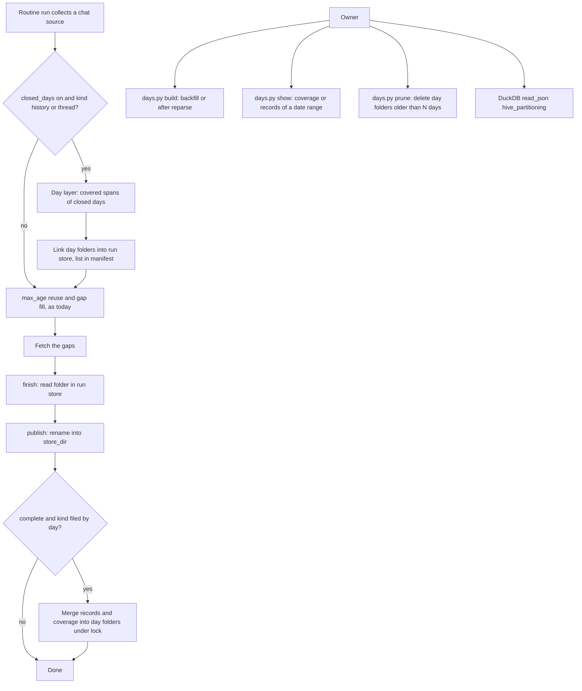
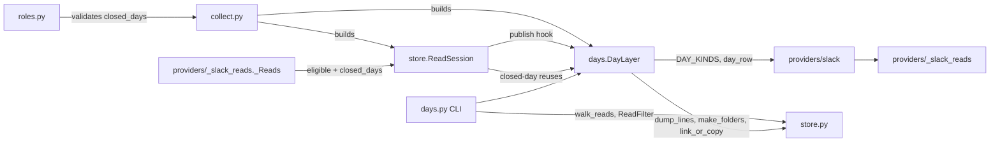
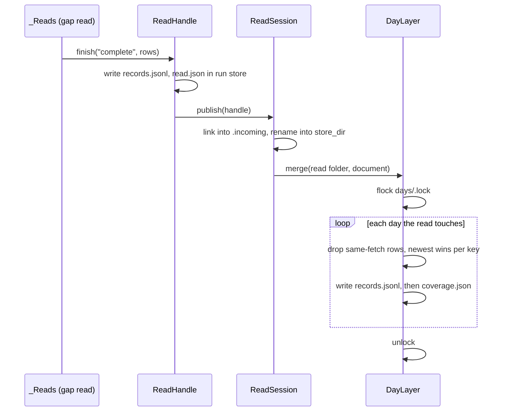
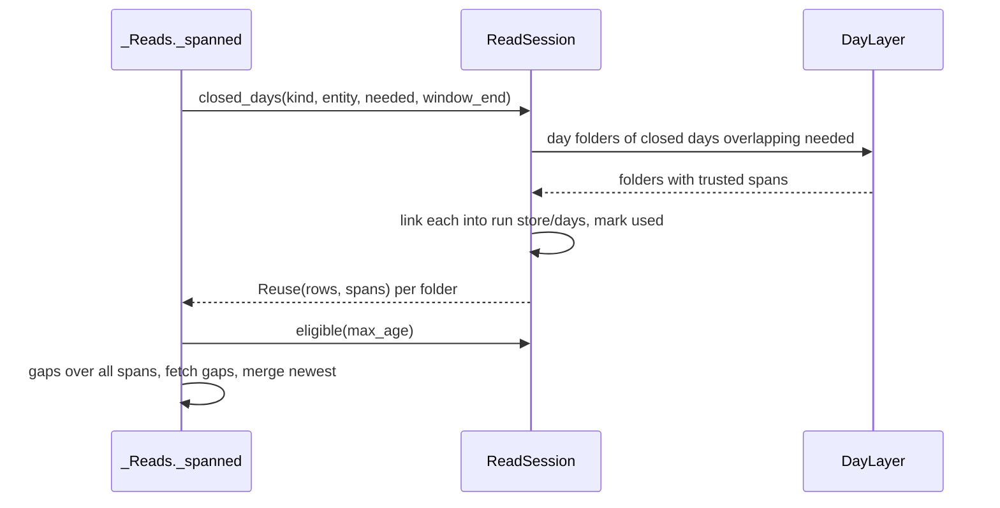

# Store By Day: Design

## Architecture Overview

A new runtime module, `days.py`, owns the day layer under `<store_dir>/days/`. It is both a library (merge, coverage, reuse) and a CLI (`build`, `show`, `prune`).

- Write path: `ReadSession.publish` renames a read into `store_dir`, then hands it to an injected `DayLayer`, which merges its records into the day folders it touches.
- Read path: the Slack `_Reads` gap fill asks the session for closed-day reuses next to the `max_age` reuses; the session asks its `DayLayer`. A reused day folder is linked into `<run>/store/days/` and listed in the manifest, so replay reads the linked copy.
- `store.py` does not import `days.py`: `collect.py` builds the `DayLayer` and passes it to the session, so no import cycle forms.
- The adapter says which kinds are filed by day and how a row maps to its ts and key (`DAY_KINDS`, `day_row`). The store code is provider-neutral.

```text
<store_dir>/
  provider=chat/kind=history/channel=C1/read=<from>_<to>-<fetch id>/   (unchanged)
  days/
    .lock
    provider=chat/kind=history/year=2026/month=10/day=26/channel=C1/
      records.jsonl     one row per message, plus fetch_id, fetched_at, transport
      coverage.json     covered spans per transport, clipped to the day
    provider=chat/kind=thread/year=2026/month=10/day=26/channel=C1/root=<ts>/
    provider=chat/kind=search/year=2026/month=10/day=26/search=<name>/
    provider=chat/kind=reactions/year=2026/month=10/day=26/channel=C1/message=<ts>/
```

## Usage Flow



## Component Diagram



## Technical Decisions

### TD-1: A separate `days/` tree

**Choice**: day folders live under `<store_dir>/days/provider=<key>/kind=<kind>/year=/month=/day=/<entity keys>/`.
**Alternatives considered**:
- Day keys inside the read tree (`provider=/kind=/channel=/year=/...`): rejected, a glob over reads would also match day files, and the read layout of provider-store would change.
- A `view=day` level under `provider=`: rejected, `prune` and `walk_reads` would need to skip it, and DuckDB globs would start at different depths for reads and days.
**Rationale**: two trees, two globs, no change to the read layout or its tools (`provider_folders` lists `provider=` names only).

### TD-2: `year=/month=/day=` before the entity keys, zero-padded

**Choice**: date levels come right after `kind=`; month and day are two digits.
**Alternatives considered**:
- A single `date=YYYY-MM-DD`: rejected by the owner, who wants folder granularity per year and month.
- Entity before date (`channel=/year=/...`): rejected, a date range over every channel would read every channel folder.
**Rationale**: one glob reads one kind as one table; a date range prunes folders by path; zero padding sorts lexically.

### TD-3: Records then coverage, each by atomic rename, under one lock

**Choice**: a merge takes an exclusive `fcntl.flock` on `days/.lock`, writes `records.jsonl` then `coverage.json`, each by `state.write_all` (temp file and `os.replace`).
**Alternatives considered**:
- One file holding both: rejected, DuckDB would read coverage lines as rows.
- Folder swap by rename: rejected, POSIX cannot rename over a non-empty folder.
- A lock per day folder: rejected, publishes are a few per minute at most; one lock is simpler and cannot deadlock across folders.
**Rationale**: readers take no lock; a reader between the two writes sees new records with old coverage, which only under-claims (BR-9). `os.replace` gives a new inode, so a run's hard link keeps the snapshot it reused.

### TD-4: Merge rule: drop the same fetch, then newest wins per key

**Choice**: merging a read first removes the folder's rows of the same fetch id, then keeps, per key, the row with the greatest `(fetched_at, fetch_id)`. Snapshot kinds (`reactions`) replace the whole folder when the incoming read is newer or the same fetch.
**Alternatives considered**:
- Last writer wins: rejected, the result would depend on publish order (AC-2.6).
- Rebuild a day from every read each time: rejected, pruned reads would erase day records (BR-8).
**Rationale**: order-independent for distinct fetches, idempotent for the same fetch, and a reparse fixes or removes its own rows.

### TD-5: Coverage spans per transport, merged, clipped with read semantics

**Choice**: `coverage.json` holds `spans: {"api": [[from, to], ...], "mcp": [...]}`. A read span `(a, b]` covers day `[D0, D0+86400)` when `a < D0+86400` and `b > D0`; the clipped span is `(max(a, D0), min(b, D0+86400)]`. Touching or overlapping spans of one transport merge.
**Alternatives considered**:
- One list with a transport per span: rejected, merging across transports would lose the trust information.
- A list of reads per day: rejected, it grows with every run and repeats the read tree.
**Rationale**: a message at exactly `D0` is covered by the previous day's span ending at `D0`, so the union of consecutive days loses nothing, and the span semantics match `store.gaps`.

### TD-6: Closed-day reuse through the existing gap fill

**Choice**: `ReadSession.closed_days(kind, entity, needed, window_end, transport)` returns one `Reuse` per used day folder, with all its rows and its spans; `Reuse` gains a `spans` field and `_gap_spans` uses it. Day reuses come first in the merge order, then the `max_age` reuses, then the gap reads.
**Alternatives considered**:
- Reuse raw reads older than `max_age` for closed days: rejected, pruned reads would be fetched again, against the durable day layer.
- A separate path that builds the collection from day files: rejected, it would duplicate the gap fill and the thread rules.
**Rationale**: the gap fill, thread rules and `_needed` filter stay one code path; the thread root row survives because rows are not filtered by span.

### TD-7: Replay reads linked day copies

**Choice**: a used day folder is linked (hard link, copy across file systems) into `<run>/store/days/<same path>` on first use, then always read from that copy; its path `days/...` goes into the manifest's `reads`. `ReplaySession.closed_days` reads only recorded day folders under the run store.
**Alternatives considered**:
- Record the day rows inside the manifest: rejected, the manifest would carry message text.
**Rationale**: the run folder replays alone, as provider-store AC-6.6 requires; a later merge into the shared day folder never changes the run's copy (TD-3).

### TD-8: `days.py` as its own CLI

**Choice**: `days.py build|show|prune --root <store_dir>`, exit codes as `store.py` (2 input, 3 rejected).
**Alternatives considered**:
- `store.py days ...`: rejected, `store.py` would import the day module that already imports it.
**Rationale**: matches the runtime's one-script-per-concern layout (`recap.py`, `store.py`, `collect.py`).

### TD-9: `closed_days` chat source key

**Choice**: `closed_days: true` on a chat source; boolean, omitted means off. Carried in `Freshness(max_age, window_end, closed_days)`.
**Alternatives considered**:
- A `closed` key inside `max_age`: rejected, `max_age` counts minutes and the closed-day rule ignores age.
**Rationale**: one explicit switch, validated by `roles.py` like the other chat keys.

### TD-10: Provider-neutral store code, adapter hooks

**Choice**: an adapter declares `DAY_KINDS = {kind: "span" | "snapshot"}` and `day_row(kind, entity, row) -> (ts, key)`, plus `snapshot_ts(kind, entity) -> ts` when it has a snapshot kind, so a snapshot with no row still has a day. An adapter without `DAY_KINDS` gets no day layer.
**Alternatives considered**:
- Slack logic inside `days.py`: rejected, the next provider would fork it.
**Rationale**: the next provider that moves to the read store adds two hooks.

## Implementation Considerations

### Data Model

Day record (one JSON line, keys sorted): the adapter row as the read holds it, plus `fetch_id`, `fetched_at` and `transport`. A record holds no value its path holds.

| Kind | Day of a row | Key | Coverage |
|---|---|---|---|
| `history` | row `ts` | `ts` | spans |
| `thread` | row `ts` | `ts` | spans |
| `search` | row `item.ts` | `channel:item.ts` | spans |
| `reactions` | entity `message` | whole folder | newest fetch |

`coverage.json`:

```json
{"schema": 1, "provider": "chat", "kind": "history", "entity": {"channel": "C1"}, "day": "2026-10-26",
 "spans": {"mcp": [["1792972800", "1793059200"]]}, "snapshot": null}
```

For `reactions`, `spans` is `{}` and `snapshot` is `{"fetch_id": ..., "fetched_at": ..., "transport": ...}`.

Rows are ordered by `(ts, key)` (AC-2.6).

### Closed days

- Day `d` is closed when `D0 + 86400 <= window_end`.
- Only `history` and `thread` are reused; spans of the source's trusted transports (`api` only for an `api` source, both for `mcp`).
- An `api` source skips a folder holding any `mcp` row.

### DuckDB

```sql
SELECT * FROM read_json('<store_dir>/days/provider=chat/kind=history/*/*/*/*/records.jsonl',
                        hive_partitioning = true, hive_types_autocast = false)
WHERE year = '2026' AND month = '10' AND day = '26' AND channel = 'C1';
```

### Security

- The day layer is under `store_dir`, which `check_store_dir` keeps outside every git working tree, or inside one that ignores it, and owned by the user; folders 0700, files 0600.
- `show --records` prints text as JSON strings; nothing is executed or interpreted.
- Entity values go through `store.folder_part`, which refuses `/`, `\`, `=`, NUL, `.` and `..`.

## Sequence Diagrams

### Publish and merge



### Closed-day reuse



## File Inventory

| File | Action | Purpose |
|------|--------|---------|
| `plugins/claudio-routines/runtime/days.py` | new | `DayLayer` (merge, coverage, closed-day reuse), `build`/`show`/`prune` CLI |
| `plugins/claudio-routines/runtime/test_days.py` | new | Day layer and CLI tests |
| `plugins/claudio-routines/runtime/store.py` | modify | `Reuse.spans`, `days` hook on `ReadSession` (publish, `closed_days`), replay of linked day folders |
| `plugins/claudio-routines/runtime/test_store.py` | modify | Publish hook and replay of day reuses |
| `plugins/claudio-routines/runtime/providers/_slack_reads.py` | modify | `DAY_KINDS`, `day_row`, `Freshness.closed_days`, closed-day reuse in `_Reads` |
| `plugins/claudio-routines/runtime/providers/slack.py` | modify | Expose `DAY_KINDS`, `day_row`; pass `closed_days` |
| `plugins/claudio-routines/runtime/providers/test_slack_reads.py` | modify | Closed-day reuse in the gap fill |
| `plugins/claudio-routines/runtime/providers/test_conformance.py` | modify | Day hooks come in pairs |
| `plugins/claudio-routines/runtime/collect.py` | modify | Build and inject `DayLayer`; count reads when `closed_days` is on |
| `plugins/claudio-routines/runtime/test_collect.py` | modify | Day layer wiring, manifest and replay |
| `plugins/claudio-routines/runtime/roles.py` | modify | `closed_days` chat key |
| `plugins/claudio-routines/runtime/test_roles.py` | modify | `closed_days` validation |
| `plugins/claudio-routines/README.md` | modify | Day layer section, `closed_days`, `days.py`, DuckDB query |
| `plugins/claudio-routines/runtime/providers/README.md` | modify | Day hooks of a store adapter |
| `docs/features/store-by-day/*.md` | new | This spec |

## Non-Functional Requirements

- A merge touches only the day folders of one read and holds the lock for that read only *(NFR-1)*
- `days.py build` over 10,000 reads finishes in under a minute on a laptop disk *(NFR-2)*
- The same inputs give byte-identical day files whatever the publish order *(NFR-3)*
- A day-layer failure during publish never fails the run: the read stays published, the error is printed to stderr with the read path, and `days.py build` repairs it *(NFR-4)*
- No new dependency: standard library only, Python 3.10 *(NFR-5)*
- Tests are deterministic: fixed clocks, temp folders, no network *(NFR-6)*
